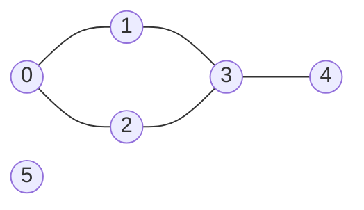
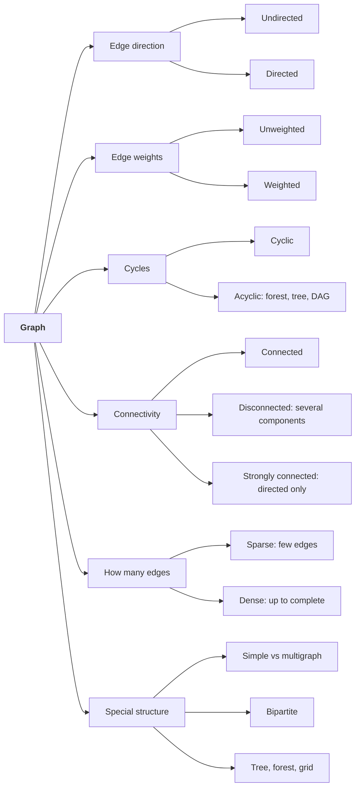
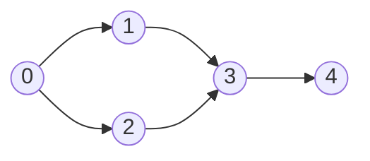
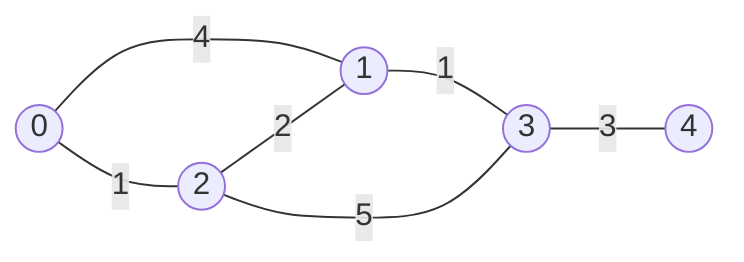

# Graphs Notes: From the Simple Idea to Shortest Paths and Spanning Trees

Oct 13, 2026 · @Rishabh Toki

The teaching companion to [graphs.md](../data-structures/graphs.md). A graph is the
general structure behind maps, social networks, web links and task dependencies. A
**tree is a special graph** (see [trees](trees-notes.md)), so everything you learned
about tree traversal carries over, with one new problem: graphs can have **cycles**, so
you must remember where you have already been.

> **Status: preview — not yet read.** Written so the reading lands quickly; expand it
> as you work through the topic.

## How this file is organised

The same example is used throughout, so each level builds on the one before.

| Level | Goal | What you get |
|---|---|---|
| [**Level 1: The simple version**](#level-1-the-simple-version) | Know what a graph is and picture it | Plain words, one small graph, vocabulary, and the types of graphs |
| [**Level 2: Storing and walking a graph**](#level-2-storing-and-walking-a-graph) | Store a graph and visit every vertex | Adjacency list vs matrix, BFS, DFS, connected components, with traces |
| [**Level 3: Traversal in depth**](#level-3-traversal-in-depth) | Know why it works and what it costs | Complexity, why BFS finds shortest paths, path rebuilding, cycle detection, grids, types in depth (bipartite) |
| [**Level 4: Directed graphs and ordering**](#level-4-directed-graphs-and-ordering) | Handle one-way edges | DAGs, topological sort, cycle detection in directed graphs |
| [**Level 5: Weighted graphs and shortest paths**](#level-5-weighted-graphs-and-shortest-paths) | Find cheapest routes | Dijkstra's algorithm with a heap, traced |
| [**Level 6: Spanning trees**](#level-6-spanning-trees) | Connect everything as cheaply as possible | Prim's and Kruskal's algorithms, Union-Find |
| [**Level 7: Interview playbook**](#level-7-interview-playbook) | Recognise and choose | Which algorithm for which problem, mistakes, a mixed practice set |

**The running example (Levels 1–3):** six vertices numbered `0` to `5` and five edges.
Levels 4–6 use small graphs built for each topic.

> **Dijkstra's algorithm (Level 5)** is the topic that was deliberately saved from the
> [heap notes](heaps-notes.md). It builds on the heap's
> [lazy deletion](heaps-notes.md#lazy-deletion-and-stale-entries) pattern, so reread
> that section just before Level 5.

---

## Level 1: The simple version

### What is a graph?

A **graph** is a set of **things** and the **connections** between them.

- The things are called **vertices** (or **nodes**).
- The connections are called **edges**.

You already use graphs every day:

| Thing (vertex) | Connection (edge) |
|---|---|
| A city | A road between two cities |
| A person | A friendship |
| A web page | A link from one page to another |
| A course | "You must take this one first" |
| A computer | A network cable |

Graphs are for questions about **connections**: Can I get from here to there? What is the
shortest way? Is everything connected? In what order should I do these tasks?

### Seeing it

Here is the graph used in the next three levels:



In words:

- Vertices: `0, 1, 2, 3, 4, 5` (6 of them).
- Edges: `0–1`, `0–2`, `1–3`, `2–3`, `3–4` (5 of them).
- Vertex `5` is on its own, with no connections.
- The edges `0–1–3–2–0` form a loop.

### Vocabulary

| Term | Meaning | In the picture |
|---|---|---|
| **Vertex / node** | A thing | `0`, `1`, … |
| **Edge** | A connection between two vertices | `0–1` |
| **Adjacent / neighbours** | Joined by an edge | `0` and `1` are neighbours |
| **Degree** | How many edges touch a vertex | degree(3) = 3; degree(4) = 1; degree(5) = 0 |
| **Path** | A route along edges | `0 → 1 → 3 → 4` |
| **Cycle** | A path that returns to its start | `0 → 1 → 3 → 2 → 0` |
| **Connected** | Every vertex can reach every other | This graph is **not** (5 is cut off) |
| **Connected component** | A maximal group that is connected | `{0,1,2,3,4}` and `{5}`: two components |

Two quick facts: with `V` vertices and `E` edges, the degrees add up to `2E` (each edge
is counted at both ends), and a graph with no cycles that is connected is a **tree**.

### Graph vs tree

A tree is a graph with two extra rules: it is **connected** and has **no cycles**. That
is why a tree with `n` vertices has exactly `n − 1` edges, and why there is exactly one
path between any two of its vertices. A general graph can have cycles, several
components, and any number of edges, so it needs more care.

| | Tree | Graph |
|---|---|---|
| Has a root | Yes | No |
| Cycles | Never | Allowed |
| Paths between two vertices | Exactly one | Zero, one or many |
| Edges for `n` vertices | `n − 1` | Anything |

### Directed, undirected, weighted

Edges can carry extra information:

- **Undirected:** the edge works both ways (a road you can drive either way, a mutual
  friendship). This is the running example.
- **Directed:** the edge has a direction, drawn as an arrow `A → B` (a one-way street,
  "I follow you", "take course A before course B").
- **Weighted:** each edge has a number on it: a distance, a cost, a time. Unweighted
  graphs just count edges.

### Types of graphs

Graphs are classified along **several independent questions**, not one ladder. Any real
graph has an answer on *each* axis: for example, a road network is **undirected,
weighted, cyclic, connected and sparse**.



| Type | Plain meaning | Example |
|---|---|---|
| **Undirected** | Edges work both ways | Roads, friendships |
| **Directed** (digraph) | Edges are one-way arrows | "Follows" on social media, web links, prerequisites |
| **Unweighted** | All edges are equal; only the count matters | "Who is friends with whom" |
| **Weighted** | Each edge carries a number (cost, distance, time) | Road lengths, flight prices |
| **Cyclic** | Contains at least one cycle | The running example (`0–1–3–2–0`) |
| **Acyclic** | Contains no cycle | A family tree, a task list |
| **Tree** | Connected and acyclic (undirected) | A folder structure |
| **Forest** | Several trees side by side (acyclic, maybe not connected) | Many separate folder trees |
| **DAG** | Directed and acyclic | Course prerequisites, build steps |
| **Connected** | You can get from any vertex to any other | A road network on one island |
| **Disconnected** | Some vertices cannot reach others; it has several components | The running example (`5` is alone) |
| **Strongly connected** | Directed: every vertex can reach every other *following the arrows* | A one-way ring road |
| **Simple graph** | At most one edge between two vertices, and no vertex joined to itself | The usual assumption |
| **Multigraph** | Allows several edges between the same pair, or an edge from a vertex to itself (a *self-loop*) | Several flights between two cities |
| **Complete graph** | Every pair of vertices is joined | Everyone is friends with everyone |
| **Sparse / dense** | Few edges / close to the maximum possible | A road network is sparse; a "complete" one is dense |
| **Bipartite** | Vertices split into two groups, and edges only go *between* the groups | Workers and the jobs they can do |

If a problem does not say, assume **simple, undirected and unweighted**.

### Level 1 check

1. In the running example, what is the degree of vertex `2`? Of vertex `5`?
2. Name a path from `4` to `0`, and name a cycle.
3. How many connected components does the graph have, and what are they?
4. What two rules turn a graph into a tree?
5. Give one example from daily life of a *directed* graph and one of a *weighted* one.
6. Classify the running example on each axis: directed or not, weighted or not, cyclic or
   not, connected or not.
7. What is the difference between a tree, a forest and a DAG?
8. Is a graph with two flights between the same pair of cities a simple graph? What is it called?

---

## Level 2: Storing and walking a graph

### Storing a graph: three ways

**1. Adjacency list.** For each vertex, a list of its neighbours.

```
0: [1, 2]
1: [0, 3]
2: [0, 3]
3: [1, 2, 4]
4: [3]
5: []
```

**2. Adjacency matrix.** A `V × V` grid; a `1` at row `u`, column `v` means an edge `u–v`.

```
     0  1  2  3  4  5
0  [ 0, 1, 1, 0, 0, 0 ]
1  [ 1, 0, 0, 1, 0, 0 ]
2  [ 1, 0, 0, 1, 0, 0 ]
3  [ 0, 1, 1, 0, 1, 0 ]
4  [ 0, 0, 0, 1, 0, 0 ]
5  [ 0, 0, 0, 0, 0, 0 ]
```

**3. Edge list.** Just the edges: `(0,1) (0,2) (1,3) (2,3) (3,4)`.

| | Adjacency list | Adjacency matrix |
|---|---|---|
| Memory | `O(V + E)` | `O(V²)` |
| Is there an edge `u–v`? | `O(degree(u))` | **`O(1)`** |
| List the neighbours of `u` | **`O(degree(u))`** | `O(V)` |
| Best for | **Sparse** graphs (few edges): most real ones | **Dense** graphs, or very frequent edge checks |

Most real graphs are sparse (a person knows thousands of people, not billions), so the
**adjacency list is the default**. The edge list is handy as input, for example for
Kruskal's algorithm in Level 6.

### Adjacency list in Java

```java
int n = 6;
List<List<Integer>> adj = new ArrayList<>();
for (int i = 0; i < n; i++) adj.add(new ArrayList<>());

void addEdge(int u, int v) {          // undirected: record it at both ends
    adj.get(u).add(v);
    adj.get(v).add(u);
}
// for a directed edge u → v, only: adj.get(u).add(v);

addEdge(0, 1); addEdge(0, 2); addEdge(1, 3); addEdge(2, 3); addEdge(3, 4);
```

### Breadth-first search (BFS)

**Idea:** visit the start, then all its neighbours, then *their* neighbours, and so on:
**ring by ring** outward. This is level-order traversal from trees, with one addition: a
`visited` record so cycles don't trap you.

It uses a **queue**: first in, first out keeps the rings in order.

**The logic, step by step:**

```
BFS(start):
    distance[every vertex] = -1                    (-1 means "not seen yet")
    distance[start] = 0
    put start into a QUEUE

    WHILE the queue is not empty:
        u = take the vertex at the FRONT of the queue
        FOR EACH neighbour v of u:
            IF distance[v] is -1:                  (first time we see v)
                distance[v] = distance[u] + 1
                put v at the BACK of the queue

    RETURN distance
```

**Reading it:**

- The queue holds vertices that are **seen but not yet explored**.
- We always take from the **front** and add to the **back**, so older vertices are
  explored first. That is what produces the "rings": everything 1 step away, then
  everything 2 steps away, and so on.
- `distance` does two jobs: it records how far each vertex is, and `-1` doubles as the
  "not visited" marker. We set it at the moment we **add** a vertex to the queue, so no
  vertex can be added twice.
- Every vertex enters the queue at most once, so the `WHILE` loop runs at most `V` times,
  and each edge is looked at a constant number of times: `O(V + E)`.

**The same thing in Java:**

```java
int[] bfs(List<List<Integer>> adj, int start) {
    int[] dist = new int[adj.size()];
    Arrays.fill(dist, -1);                 // -1 means "not visited yet"
    Queue<Integer> q = new ArrayDeque<>();
    dist[start] = 0;
    q.add(start);
    while (!q.isEmpty()) {
        int u = q.poll();
        for (int v : adj.get(u)) {
            if (dist[v] == -1) {           // first time we see v
                dist[v] = dist[u] + 1;
                q.add(v);
            }
        }
    }
    return dist;
}
```

Trace from vertex `0` on the running example (queue written front → back):

| Step | Take from queue | New vertices found | Queue after | Order so far |
|---|---|---|---|---|
| 1 | 0 | 1, 2 | 1, 2 | 0 |
| 2 | 1 | 3 (0 already seen) | 2, 3 | 0 1 |
| 3 | 2 | none (0 and 3 already seen) | 3 | 0 1 2 |
| 4 | 3 | 4 (1 and 2 already seen) | 4 | 0 1 2 3 |
| 5 | 4 | none | empty | 0 1 2 3 4 |

Result `dist = [0, 1, 1, 2, 3, -1]`: vertex `4` is 3 edges from `0`, and vertex `5` is
`-1` because it can never be reached.

### Depth-first search (DFS)

**Idea:** go as deep as you can down one path, and only back up when you hit a dead
end. This is pre-order traversal from trees, again with a `visited` record. It uses a
**stack**, usually the recursion's own call stack.

**The logic, step by step:**

```
DFS(u):
    mark u as visited
    process u                                      (print it, count it, …)
    FOR EACH neighbour v of u:
        IF v is not visited:
            DFS(v)                                 (dive in before looking at the next neighbour)
```

**Reading it:**

- The function calls **itself** on the first unvisited neighbour, which immediately calls
  itself on *its* first unvisited neighbour, and so on. That is the "go deep" part.
- When a vertex has no unvisited neighbours left, its call simply **returns**, and
  control drops back to the vertex that called it, which carries on with *its* next
  neighbour. "Backing up" is nothing more than returning from a function call.
- The `visited` mark is what stops it walking around a cycle forever.

**The same thing in Java:**

```java
void dfs(List<List<Integer>> adj, int u, boolean[] visited) {
    visited[u] = true;
    visit(u);                                  // do something with u
    for (int v : adj.get(u))
        if (!visited[v]) dfs(adj, v, visited);
}
```

Trace from `0`:

```
dfs(0): visit 0
  neighbour 1: dfs(1): visit 1
    neighbour 0: seen
    neighbour 3: dfs(3): visit 3
      neighbour 1: seen
      neighbour 2: dfs(2): visit 2
        neighbour 0: seen, neighbour 3: seen → return
      neighbour 4: dfs(4): visit 4 → return
  neighbour 2: seen → return
Order: 0 1 3 2 4
```

An explicit-stack version (the same idea as the iterative tree traversals). First the logic:

```
DFS_ITERATIVE(start):
    put start on a STACK
    WHILE the stack is not empty:
        u = take the vertex from the TOP of the stack
        IF u is already visited: skip it           (it may have been pushed more than once)
        mark u as visited
        process u
        FOR EACH neighbour v of u:
            IF v is not visited: put v on the stack
```

Here the stack replaces the recursion's call stack. Unlike BFS, we mark a vertex visited
when we **take it off** the stack, because a vertex can be pushed several times by
different neighbours before it is first reached, so we check again when it comes out.

```java
void dfsIter(List<List<Integer>> adj, int start) {
    boolean[] visited = new boolean[adj.size()];
    Deque<Integer> stack = new ArrayDeque<>();
    stack.push(start);
    while (!stack.isEmpty()) {
        int u = stack.pop();
        if (visited[u]) continue;              // may have been pushed more than once
        visited[u] = true;
        visit(u);
        for (int v : adj.get(u))
            if (!visited[v]) stack.push(v);
    }
}
```

This visits `0 2 3 4 1` on the example. That differs from the recursive order
`0 1 3 2 4`, and **both are valid depth-first orders**: the stack pops the *last* pushed
neighbour first. Push neighbours in reverse if you want to match the recursive order.

### BFS vs DFS at a glance

| | BFS | DFS |
|---|---|---|
| Container | Queue | Stack / recursion |
| Explores | Ring by ring | Deep path first |
| Tree analogue | Level-order | Pre-order |
| Finds shortest path (unweighted)? | **Yes** | No |

### Connected components

To count or label the components, start a traversal from every vertex not yet visited;
each new start is a new component.

**The logic, step by step:**

```
COUNT_COMPONENTS:
    count = 0
    FOR EACH vertex s from 0 to V-1:
        IF s is not visited:
            count = count + 1                      (a brand-new, unexplored group)
            explore everything reachable from s, marking it visited   (DFS or BFS)
    RETURN count
```

**Reading it:** the traversal from `s` marks the *whole* group visited, so every other
vertex in that group is skipped by the `IF`. Each time the `IF` fires, we have stumbled
on a group we had not seen: one more component.

**The same thing in Java:**

```java
int countComponents(List<List<Integer>> adj) {
    boolean[] visited = new boolean[adj.size()];
    int count = 0;
    for (int s = 0; s < adj.size(); s++) {
        if (!visited[s]) {
            count++;                           // found a new, unexplored component
            dfs(adj, s, visited);
        }
    }
    return count;
}
```

On the running example: starting at `0` explores `{0,1,2,3,4}`; starting at `5` finds
`{5}`. The answer is **2**.

### Level 2 check

1. Write the adjacency list of the path graph `0–1–2–3`.
2. For a graph with 1,000 vertices and 2,000 edges, which storage would you choose and why?
3. Trace BFS from vertex `4` on the running example. What are the distances?
4. Why does a graph traversal need a `visited` record when a tree traversal does not?
5. DFS and iterative DFS gave different orders on the same graph. Why is that fine?

---

## Level 3: Traversal in depth

### Complexity

| | Adjacency list | Adjacency matrix |
|---|---|---|
| BFS or DFS time | **`O(V + E)`** | `O(V²)` |
| Extra memory | `O(V)` (visited array plus queue or stack) | `O(V)` |

**Why `O(V + E)`:** each vertex is taken off the queue (or stack) once, and when it is,
we look at each of its edges once. Add up all the vertices' work and you get `V` plus the
sum of degrees, which is `2E` for an undirected graph. With a matrix, finding a vertex's
neighbours means scanning a whole row of length `V`, so it is `V × V`.

### Why BFS finds shortest paths

BFS visits vertices in **non-decreasing order of distance**: first everything 1 edge
away, then everything 2 edges away, and so on. The first time BFS reaches a vertex, it
has therefore arrived by a path with the fewest edges. That makes BFS the right tool for
the **shortest path in an unweighted graph** (or "fewest steps", "fewest moves",
"fewest hops").

DFS has no such guarantee: it can find a long, winding path to a vertex first.

### Rebuilding the path

Distances tell you *how far*; to get the route itself, record each vertex's **parent**
(the vertex it was discovered from), then walk backwards from the target.

**The logic, step by step:**

```
(inside BFS)  when we discover v from u:   parent[v] = u        (start's parent stays "none")

PATH_TO(target):
    path = empty list
    v = target
    WHILE v is not "none":
        put v at the FRONT of path
        v = parent[v]                              (step one vertex back toward the start)
    RETURN path
```

**Reading it:** following `parent` links takes us from the target *backwards* to the
start. Because we add each vertex to the **front** of the list, the list ends up in the
right order (start … target).

**The same thing in Java:**

```java
int[] parent = new int[n];
Arrays.fill(parent, -1);
// in BFS, when you discover v from u:   parent[v] = u;

List<Integer> pathTo(int target, int[] parent) {
    LinkedList<Integer> path = new LinkedList<>();
    for (int v = target; v != -1; v = parent[v]) path.addFirst(v);
    return path;                               // start … target (check path.get(0) == start)
}
```

For vertex `4` in the example, the parents give `4 ← 3 ← 1 ← 0`, so the path is
`0 → 1 → 3 → 4`.

### Mark visited when you enqueue, not when you dequeue

In BFS, set `dist[v]` (or `visited[v] = true`) at the moment you **add** `v` to the
queue, as the code above does. If you wait until you remove it, the same vertex can be
added many times by different neighbours, which wastes time and, in the worst case,
inflates the cost well beyond `O(V + E)`.

### Cycle detection (undirected graphs)

A cycle exists if, during DFS, you reach an already-visited vertex that is **not** the
one you just came from.

**The logic, step by step:**

```
HAS_CYCLE:
    FOR EACH vertex s:
        IF s is not visited AND EXPLORE(s, parent = none) finds a cycle:
            RETURN true
    RETURN false

EXPLORE(u, parent):
    mark u as visited
    FOR EACH neighbour v of u:
        IF v is the parent: skip it                (that is just the edge we arrived by)
        IF v is already visited: RETURN true       (we reached v by another route: a loop)
        IF EXPLORE(v, u) finds a cycle: RETURN true
    RETURN false
```

**Reading it:** in an undirected graph every edge can be walked in both directions, so
the neighbour we just came from always looks "already visited". That one does not count,
which is why we pass the `parent` down and skip it. Any *other* visited neighbour means
there are two different routes to the same place, which is exactly a cycle. The outer
loop is there because the graph might be disconnected.

**The same thing in Java:**

```java
boolean hasCycle(List<List<Integer>> adj) {
    boolean[] visited = new boolean[adj.size()];
    for (int s = 0; s < adj.size(); s++)
        if (!visited[s] && dfsCycle(adj, s, -1, visited)) return true;
    return false;
}

boolean dfsCycle(List<List<Integer>> adj, int u, int parent, boolean[] visited) {
    visited[u] = true;
    for (int v : adj.get(u)) {
        if (v == parent) continue;             // that is just the edge we arrived by
        if (visited[v] || dfsCycle(adj, v, u, visited)) return true;
    }
    return false;
}
```

The running example has a cycle (`0 → 1 → 3 → 2 → 0`); the path graph `0–1–2–3` does not.
(Directed graphs need a different test, in Level 4.)

### Grids are graphs

Many problems hide a graph in a **grid**: each cell is a vertex, and its up/down/left/
right neighbours are its edges. You never build an adjacency list; you compute the
neighbours on the fly. Example, **count the islands** in a grid of `'1'` (land) and `'0'`
(water):

**The logic, step by step:**

```
COUNT_ISLANDS(grid):
    count = 0
    FOR EACH cell (r, c) in the grid:
        IF the cell is land:
            count = count + 1                      (found an island we have not erased yet)
            SINK(r, c)
    RETURN count

SINK(r, c):
    IF (r, c) is outside the grid OR the cell is not land: STOP
    turn the cell into water                       (this is the "visited" mark)
    SINK the four neighbours: below, above, right, left
```

**Reading it:** `SINK` is DFS on the grid. It erases the entire island connected to the
starting cell, so the scan never counts the same island twice. Turning land into water
doubles as the `visited` record, so no extra array is needed.

**The same thing in Java:**

```java
int numIslands(char[][] grid) {
    int count = 0;
    for (int r = 0; r < grid.length; r++)
        for (int c = 0; c < grid[0].length; c++)
            if (grid[r][c] == '1') {           // an unexplored island
                count++;
                sink(grid, r, c);
            }
    return count;
}

void sink(char[][] g, int r, int c) {
    if (r < 0 || c < 0 || r >= g.length || c >= g[0].length || g[r][c] != '1') return;
    g[r][c] = '0';                             // mark visited by overwriting
    sink(g, r + 1, c); sink(g, r - 1, c); sink(g, r, c + 1); sink(g, r, c - 1);
}
```

This is exactly "count connected components" from Level 2, on an implicit graph. For
"fewest steps from cell A to cell B", use BFS the same way.

### Types of graphs in depth

**How many edges can there be?** In a simple graph with `V` vertices:

| Graph | Maximum edges |
|---|---|
| Undirected, complete | `V(V − 1) / 2` |
| Directed, complete (an arrow each way for every pair) | `V(V − 1)` |

For `V = 1,000` that is `499,500` undirected edges. Real graphs have far fewer, which is
why they are **sparse** and why the adjacency list (`O(V + E)`) beats the matrix
(`O(V²)`). A graph is called **dense** when `E` is close to that maximum, and only then
does a matrix start to make sense.

**Multigraphs and self-loops.** An adjacency list handles parallel edges naturally (the
same neighbour appears twice, possibly with different weights). A matrix would need to
store a *count* or a list in each cell. Self-loops show up as a vertex in its own
neighbour list. Most interview problems state "simple graph" and let you ignore both.

**Directed connectivity has two strengths.** A directed graph is **strongly connected**
if there is a path from every vertex to every other *following the arrows*; it is
**weakly connected** if it would be connected once you ignored the arrow directions. A
one-way street network where you can get in but never out is only weakly connected.
(Finding the strongly connected *parts* of a directed graph is a separate algorithm; see
"Going further" in Level 7.)

**Trees, forests and DAGs relate like this:** a tree is a connected acyclic undirected
graph; a forest is a collection of trees; a DAG is the directed analogue of "no cycles"
but may have many paths between two vertices, so it is **not** a tree.

**Bipartite graphs, and how to test for one.** A graph is **bipartite** if you can colour
every vertex with one of two colours so that **no edge joins two vertices of the same
colour**. Equivalent facts: it has **no odd-length cycle**, and it is a natural model for
"two kinds of things": students and courses, workers and jobs.

**Test:** run BFS and give each newly found vertex the *opposite* colour of the vertex it
was found from. If you ever meet a neighbour that already has your own colour, the graph
is not bipartite.

**The logic, step by step:**

```
IS_BIPARTITE:
    colour[every vertex] = none
    FOR EACH vertex s:                             (the graph may be disconnected)
        IF s has no colour:
            colour[s] = A
            put s into a QUEUE
            WHILE the queue is not empty:
                u = take the vertex at the FRONT
                FOR EACH neighbour v of u:
                    IF v has no colour:
                        colour[v] = the OPPOSITE of colour[u]
                        put v into the queue
                    ELSE IF colour[v] == colour[u]:
                        RETURN false               (an edge joins two vertices of the same colour)
    RETURN true
```

**Reading it:** this is plain BFS where "visited" is replaced by "coloured". Neighbours
must be in the *other* group, so each new vertex gets the opposite colour. Meeting a
neighbour that already has **your own** colour is a contradiction, so no valid two-group
split exists.

**The same thing in Java:**

```java
boolean isBipartite(List<List<Integer>> adj) {
    int n = adj.size();
    int[] color = new int[n];                  // 0 = uncoloured, 1 and -1 = the two groups
    for (int s = 0; s < n; s++) {              // loop, because the graph may be disconnected
        if (color[s] != 0) continue;
        color[s] = 1;
        Queue<Integer> q = new ArrayDeque<>();
        q.add(s);
        while (!q.isEmpty()) {
            int u = q.poll();
            for (int v : adj.get(u)) {
                if (color[v] == 0) {
                    color[v] = -color[u];      // opposite colour
                    q.add(v);
                } else if (color[v] == color[u]) {
                    return false;              // two neighbours in the same group
                }
            }
        }
    }
    return true;
}
```

On the running example, the colours come out `0:+, 1:−, 2:−, 3:+, 4:−`, so it **is**
bipartite (its only cycle, `0–1–3–2`, has even length 4). A triangle `0–1–2` is not: `0`
gets `+`, `1` and `2` both get `−`, and then edge `1–2` joins two vertices of the same
colour. Cost: `O(V + E)`.

### Level 3 check

1. Why is BFS `O(V + E)`, and why is it `O(V²)` with an adjacency matrix?
2. Why does BFS give shortest paths in an unweighted graph, and DFS does not?
3. How do you rebuild the actual path, not just its length?
4. What goes wrong if you mark a vertex visited only when you dequeue it?
5. How is "number of islands" a connected-components problem?
6. What is the maximum number of edges in a simple undirected graph with 10 vertices?
   Is a graph with 12 edges on 10 vertices sparse or dense?
7. What is the difference between strongly and weakly connected?
8. Is a triangle bipartite? Is a square (4-cycle)? State the rule about cycle length.
9. Colour the running example with the BFS bipartite test and list each vertex's colour.

---

## Level 4: Directed graphs and ordering

### Directed graphs and DAGs

In a **directed** graph each edge points one way, so we split a vertex's degree in two:
**out-degree** (edges leaving it) and **in-degree** (edges arriving). A directed graph
with **no cycles** is a **DAG** (directed acyclic graph). DAGs model anything with
"must happen before" rules: course prerequisites, build steps, task dependencies.

Here is a small set of tasks: `0` must come before `1` and `2`, both of those before `3`,
and `3` before `4`.



Adjacency list (directed, so each edge appears once): `0: [1, 2]`, `1: [3]`, `2: [3]`,
`3: [4]`, `4: []`.

### Topological sort (Kahn's algorithm)

**Question:** list the tasks in an order that respects every "before" rule.

**Idea:** a task with **no remaining prerequisites** (in-degree 0) can safely go next.
Do it, remove its outgoing edges (lowering its neighbours' in-degree), and repeat. It is
BFS with an in-degree count.

**The logic, step by step:**

```
TOPO_SORT:
    count indegree[v] for every vertex      (how many edges point INTO v)
    put every vertex with indegree 0 into a QUEUE
    order = empty list

    WHILE the queue is not empty:
        u = take the vertex at the FRONT
        append u to order
        FOR EACH vertex v that u points to:
            indegree[v] = indegree[v] - 1          (u is done, so v waits for one fewer task)
            IF indegree[v] == 0:
                put v into the queue               (v has nothing left to wait for)

    IF order has fewer than V vertices: RETURN "cycle"
    RETURN order
```

**Reading it:**

- A vertex with in-degree 0 has **no unfinished prerequisites**, so it can safely go
  next.
- "Finishing" `u` removes its outgoing edges, which may free its neighbours.
- If there is a cycle, its vertices wait on each other and never reach 0, so they are
  never added to `order`, and the final length check catches it.

**The same thing in Java:**

```java
List<Integer> topoSort(List<List<Integer>> adj) {           // adj holds u → v edges
    int n = adj.size();
    int[] indeg = new int[n];
    for (List<Integer> outs : adj)
        for (int v : outs) indeg[v]++;

    Queue<Integer> q = new ArrayDeque<>();
    for (int i = 0; i < n; i++)
        if (indeg[i] == 0) q.add(i);                        // no prerequisites

    List<Integer> order = new ArrayList<>();
    while (!q.isEmpty()) {
        int u = q.poll();
        order.add(u);
        for (int v : adj.get(u))
            if (--indeg[v] == 0) q.add(v);                  // v's last prerequisite is done
    }
    return order.size() == n ? order : List.of();           // fewer than n ⇒ a cycle
}
```

Trace on the task graph. Starting in-degrees: `0:0, 1:1, 2:1, 3:2, 4:1`.

| Step | Take | Order so far | In-degree changes | Queue after |
|---|---|---|---|---|
| start | | | | 0 |
| 1 | 0 | 0 | `1→0`, `2→0` | 1, 2 |
| 2 | 1 | 0 1 | `3→1` | 2 |
| 3 | 2 | 0 1 2 | `3→0` | 3 |
| 4 | 3 | 0 1 2 3 | `4→0` | 4 |
| 5 | 4 | 0 1 2 3 4 | | empty |

The result `0 1 2 3 4` respects every rule. There can be **more than one valid order**
(here `0 2 1 3 4` also works); a topological sort gives *a* valid one.

### Detecting a cycle in a directed graph

If there is a cycle, its vertices wait on each other forever, so none of them ever
reaches in-degree 0. Kahn's algorithm then ends with **fewer than `n` vertices in the
order**, which is exactly the cycle test in the last line of the code. For example,
adding an edge `4 → 0` to the task graph leaves no vertex with in-degree 0 at the start,
so `order` is empty and the answer is "cycle".

(The other common method is DFS with three states per vertex: unvisited, *in progress*,
*done*. Meeting an *in progress* vertex means a cycle. Note the undirected test from
Level 3 does **not** work on directed graphs.)

### Level 4 check

1. In the task graph, what are the in-degree and out-degree of vertex `3`?
2. Give a second valid topological order of the task graph.
3. Why does a cycle make topological ordering impossible?
4. How does Kahn's algorithm detect a cycle?
5. Course prerequisites `1→2`, `2→3`, `3→1`: can a student finish all three? Why?

---

## Level 5: Weighted graphs and shortest paths

### Why BFS is not enough

BFS counts **edges**. But in a road network, one long road can be worse than three short
ones. When edges have **weights** (distance, time, cost), the fewest edges is not
necessarily the cheapest. We need an algorithm that adds up weights.

### Dijkstra's algorithm: the idea

> This is the topic deferred from the heap notes. It uses a `PriorityQueue` and the
> [lazy deletion](heaps-notes.md#lazy-deletion-and-stale-entries) trick.

**Question:** the cheapest route from one start vertex to every other vertex, when all
weights are **zero or positive**.

**Idea, in plain words:**

1. Keep a table of the **best known distance** to each vertex. Start with `0` for the
   start and "infinity" for everything else.
2. Repeatedly take the **unfinished vertex with the smallest known distance**. That
   distance is now final: nothing can beat it, because any other route would have to go
   through vertices that are even further away, and weights are not negative.
3. From that vertex, check each outgoing edge: is going **through it** a cheaper way to
   reach the neighbour than what we knew? If so, update the table.
4. Repeat until nothing is left.

Step 2 needs "the smallest of the changing set" over and over, which is exactly what a
**min-heap** is for.

### Worked example

The weighted graph:



Edges (undirected): `0–1:4`, `0–2:1`, `2–1:2`, `1–3:1`, `2–3:5`, `3–4:3`. Find the cheapest
distances from `0`.

The heap holds `(distance, vertex)` pairs. `dist` starts as `[0, ∞, ∞, ∞, ∞]`.

| Step | Pop `(d, v)` | What happens | `dist` after | Heap after |
|---|---|---|---|---|
| 1 | (0, 0) | Relax 0's edges: reach 1 at 4, reach 2 at 1 | 0, 4, 1, ∞, ∞ | (1,2) (4,1) |
| 2 | (1, 2) | Via 2: vertex 1 at 1+2 = **3** (beats 4); vertex 3 at 1+5 = 6 | 0, **3**, 1, 6, ∞ | (3,1) (4,1) (6,3) |
| 3 | (3, 1) | Via 1: vertex 3 at 3+1 = **4** (beats 6) | 0, 3, 1, **4**, ∞ | (4,1) (4,3) (6,3) |
| 4 | (4, 1) | **Stale**: 4 is worse than `dist[1] = 3`, so skip | unchanged | (4,3) (6,3) |
| 5 | (4, 3) | Via 3: vertex 4 at 4+3 = 7 | 0, 3, 1, 4, **7** | (6,3) (7,4) |
| 6 | (6, 3) | **Stale**: 6 is worse than `dist[3] = 4`, so skip | unchanged | (7,4) |
| 7 | (7, 4) | No improvement | 0, 3, 1, 4, 7 | empty |

(When two heap entries have the same distance, such as `(4,1)` and `(4,3)`, either may
come out first; the final distances are identical either way.)

**Result:** distances `[0, 3, 1, 4, 7]`. The cheapest route to vertex `4` is
`0 → 2 → 1 → 3 → 4` with cost `1 + 2 + 1 + 3 = 7`.

Steps 4 and 6 are the lazy deletion from the heap notes: when vertex 1's distance
improved from 4 to 3, the old entry `(4, 1)` was **not** removed (a `PriorityQueue` can't
cheaply do that); it just sat in the heap and was ignored when it surfaced.

### Dijkstra in Java

**The logic, step by step:**

```
DIJKSTRA(source):
    dist[every vertex] = INFINITY
    dist[source] = 0
    put (0, source) into a MIN-HEAP ordered by distance

    WHILE the heap is not empty:
        (d, u) = remove the SMALLEST entry from the heap
        IF d > dist[u]: skip it                    (stale: we already found a better route to u)
        FOR EACH edge (u → v, weight w):
            newDist = d + w
            IF newDist < dist[v]:                  (going through u is cheaper than what we knew)
                dist[v] = newDist
                put (newDist, v) into the heap     (a NEW entry; the old one just goes stale)

    RETURN dist
```

**Reading it:**

- The heap always hands us the **closest vertex we haven't finished**. Its distance is
  final, because every other route would have to pass through something even further away.
- The `IF d > dist[u]` line is the **lazy deletion** from the heap notes: an old, worse
  entry for `u` is still sitting in the heap, and we simply ignore it when it surfaces.
- "Relaxing" an edge means asking: *is the way through `u` cheaper?* If yes, we improve
  `dist[v]` and push a fresh entry.

**The same thing in Java:**

```java
record Edge(int to, int weight) {}

int[] dijkstra(List<List<Edge>> adj, int source) {
    int n = adj.size();
    int[] dist = new int[n];
    Arrays.fill(dist, Integer.MAX_VALUE);
    dist[source] = 0;

    PriorityQueue<int[]> pq = new PriorityQueue<>(Comparator.comparingInt(a -> a[0]));  // {distance, vertex}
    pq.offer(new int[]{0, source});

    while (!pq.isEmpty()) {
        int[] top = pq.poll();
        int d = top[0], u = top[1];
        if (d > dist[u]) continue;                   // stale entry: a shorter route is already known
        for (Edge e : adj.get(u)) {
            int nd = d + e.weight();
            if (nd < dist[e.to()]) {                 // going through u is cheaper
                dist[e.to()] = nd;
                pq.offer(new int[]{nd, e.to()});     // push a NEW entry; there is no decrease-key
            }
        }
    }
    return dist;                                     // MAX_VALUE = unreachable
}
```

To rebuild the route itself, record `parent[e.to()] = u` whenever you update `dist`, then
walk back from the target, as in Level 3.

### Why it works, and when it fails

- **Why it works:** the first time a vertex comes off the heap, its distance is final.
  Any other route to it would have to pass through a vertex that is at least as far
  away, and adding non-negative weights can only make it longer.
- **Cost:** each edge can push one entry, and each push or pop is `O(log n)`, so about
  **`O((V + E) log V)`** with a binary heap.
- **It fails with negative edge weights.** Then a path through a not-yet-finished
  vertex could still turn out cheaper, so "the smallest is final" is no longer true. Use
  **Bellman–Ford** for graphs with negative edges (it relaxes every edge `V − 1` times,
  `O(V·E)`).
- **Unweighted graph?** Use plain BFS: it is simpler and `O(V + E)`.

### Level 5 check

1. Why is BFS the wrong tool when edges have different weights?
2. In the worked example, why is the entry `(4, 1)` stale, and why is it safe to skip?
3. Why does Dijkstra need non-negative weights?
4. Why does the code push a *new* entry instead of lowering an existing one?
5. Run Dijkstra by hand from vertex `4` on the same graph. What is `dist[0]`?

---

## Level 6: Spanning trees

### Minimum spanning tree: the idea

**Question:** you have several sites and the cost of laying a cable between some pairs.
Connect **all** the sites using the **cheapest total cable**.

A **spanning tree** of a connected graph is a subset of its edges that connects every
vertex with **no cycles**: a tree that touches everything, which therefore has exactly
`V − 1` edges. A **minimum spanning tree (MST)** is the spanning tree with the smallest
total weight.

Using the same weighted graph as Level 5 (5 vertices, so an MST has 4 edges):


Its MST uses `0–2 (1)`, `1–3 (1)`, `2–1 (2)` and `3–4 (3)`: total **7**. The edges `0–1 (4)`
and `2–3 (5)` are left out, because adding either would create a cycle.

> Do not confuse this with shortest paths: an MST minimises the **total** of all edges
> used to connect everything, not the distance from one vertex.

### Prim's algorithm

**Idea:** grow the tree from one start vertex. At each step add the **cheapest edge that
connects the tree to a vertex outside it**. The code is nearly Dijkstra's, except the
heap is ordered by the **edge weight** alone, not the total distance from the start.

**The logic, step by step:**

```
PRIM(start):
    inTree[every vertex] = false;  total = 0
    put (0, start) into a MIN-HEAP ordered by EDGE WEIGHT

    WHILE the heap is not empty AND the tree does not yet contain every vertex:
        (w, u) = remove the SMALLEST entry
        IF inTree[u]: skip it                      (stale: u joined the tree already)
        inTree[u] = true
        total = total + w                          (pay for the edge that brought u in)
        FOR EACH edge (u – v, weight x):
            IF v is not in the tree: put (x, v) into the heap

    IF the tree does not contain every vertex: RETURN "not connected"
    RETURN total
```

**Reading it:** the heap holds the **edges that leave the tree**, cheapest first. Popping
the cheapest one and pulling its far end into the tree is the "add the cheapest edge
that connects something new" rule. It differs from Dijkstra in only one way: the heap
key is the **single edge's weight**, not the total distance from the start.

**The same thing in Java:**

```java
int prim(List<List<Edge>> adj) {
    int n = adj.size(), total = 0, count = 0;
    boolean[] inTree = new boolean[n];
    PriorityQueue<int[]> pq = new PriorityQueue<>(Comparator.comparingInt(a -> a[0]));  // {weight, vertex}
    pq.offer(new int[]{0, 0});                       // start at vertex 0, cost 0

    while (!pq.isEmpty() && count < n) {
        int[] top = pq.poll();
        int w = top[0], u = top[1];
        if (inTree[u]) continue;                     // stale: this vertex was joined already
        inTree[u] = true;
        total += w;
        count++;
        for (Edge e : adj.get(u))
            if (!inTree[e.to()]) pq.offer(new int[]{e.weight(), e.to()});
    }
    return count == n ? total : -1;                  // -1: the graph is not connected
}
```

Trace from `0`:

| Step | Pop `(w, v)` | Action | Total | Heap after |
|---|---|---|---|---|
| 1 | (0, 0) | Add 0; offer edges to 1 (4) and 2 (1) | 0 | (1,2) (4,1) |
| 2 | (1, 2) | Add 2; offer edges to 1 (2) and 3 (5) | 1 | (2,1) (4,1) (5,3) |
| 3 | (2, 1) | Add 1; offer edge to 3 (1) | 3 | (1,3) (4,1) (5,3) |
| 4 | (1, 3) | Add 3; offer edge to 4 (3) | 4 | (3,4) (4,1) (5,3) |
| 5 | (3, 4) | Add 4. All 5 vertices are in. | 7 | (4,1) (5,3) |

Total **7**. The leftover heap entries are stale and never used.

### Kruskal's algorithm and Union-Find

**Idea:** sort **all edges** by weight. Go through them cheapest first, and **keep an edge
if it does not form a cycle** with the edges already kept. Stop when you have `V − 1`.

To ask "does this edge join two vertices that are already connected?" quickly, use a
**Union-Find** (disjoint-set) structure: it tracks which group each vertex belongs to.

**The logic, step by step:**

```
FIND(x):
    follow parent links from x up to the group's leader
    on the way back, re-point every vertex we passed straight at the leader   (path compression)
    RETURN the leader

UNION(a, b):
    ra = FIND(a);  rb = FIND(b)
    IF ra == rb: RETURN false                      (already in the same group)
    attach the shorter group's tree under the taller one's leader
    RETURN true                                    (two groups became one)

KRUSKAL:
    sort all edges by weight, smallest first
    total = 0;  kept = 0
    FOR EACH edge (u, v, w) in that order:
        IF UNION(u, v) returned true:              (u and v were in different groups)
            keep the edge;  total = total + w;  kept = kept + 1
    IF kept < V - 1: RETURN "not connected"
    RETURN total
```

**Reading it:**

- Every vertex starts as its **own group**, with itself as the leader.
- `FIND` answers "which group are you in?" by returning the leader. Compressing the path
  makes later lookups almost instant.
- `UNION` merges two groups, and **refuses** (returns false) when both vertices are
  already in the same group. That refusal is exactly the "this edge would make a cycle"
  test Kruskal needs.
- Because edges are processed cheapest first, the first edge to connect two groups is
  always the cheapest way to do it.

**The same thing in Java:**

```java
class UnionFind {
    int[] parent, rank;

    UnionFind(int n) {
        parent = new int[n];
        rank = new int[n];
        for (int i = 0; i < n; i++) parent[i] = i;       // everyone starts alone
    }

    int find(int x) {                                    // which group is x in?
        return parent[x] == x ? x : (parent[x] = find(parent[x]));   // path compression
    }

    boolean union(int a, int b) {                        // merge two groups
        int ra = find(a), rb = find(b);
        if (ra == rb) return false;                      // already connected: edge would make a cycle
        if (rank[ra] < rank[rb]) { int t = ra; ra = rb; rb = t; }
        parent[rb] = ra;                                 // attach the shorter tree under the taller
        if (rank[ra] == rank[rb]) rank[ra]++;
        return true;
    }
}

int kruskal(int n, int[][] edges) {                      // each edge = {u, v, weight}
    Arrays.sort(edges, Comparator.comparingInt(e -> e[2]));
    UnionFind uf = new UnionFind(n);
    int total = 0, used = 0;
    for (int[] e : edges) {
        if (uf.union(e[0], e[1])) {                      // joins two different groups: keep it
            total += e[2];
            used++;
        }
    }
    return used == n - 1 ? total : -1;                   // -1: not connected
}
```

Trace on the example, edges sorted by weight:

| Edge (weight) | Same group already? | Decision | Total |
|---|---|---|---|
| 0–2 (1) | no | **keep** | 1 |
| 1–3 (1) | no | **keep** | 2 |
| 2–1 (2) | no ({0,2} and {1,3}) | **keep**, merges the two groups | 4 |
| 3–4 (3) | no | **keep** | 7 |
| 0–1 (4) | yes | skip (would make a cycle) | 7 |
| 2–3 (5) | yes | skip | 7 |

Total **7**, matching Prim's result. **Cost:** sorting dominates, `O(E log E)`; each
Union-Find operation is almost `O(1)` thanks to path compression and union by rank.

### Prim vs Kruskal

| | Prim | Kruskal |
|---|---|---|
| Grows | One tree outward from a start vertex | A forest of fragments that merge |
| Needs | A heap and an adjacency list | Sorted edges and Union-Find |
| Cost | `O((V + E) log V)` | `O(E log E)` |
| Tends to suit | Dense graphs | Sparse graphs, or when edges are already a list |

Union-Find is also the quick way to answer "are these two vertices connected?" and to
count components as edges arrive one at a time.

### Level 6 check

1. A connected graph has 8 vertices. How many edges does a spanning tree of it have?
2. Why can an MST never contain a cycle?
3. What is the difference between Prim's heap and Dijkstra's heap?
4. Run Kruskal's algorithm on a triangle with edge weights 1, 2 and 3. Which edges are kept?
5. What question does Union-Find answer, and why is it needed in Kruskal's algorithm?

---

## Level 7: Interview playbook

### Recognising a graph problem

| If the problem says… | Think |
|---|---|
| "connected", "number of islands / groups / provinces" | Connected components (DFS, BFS or Union-Find) |
| "fewest steps / moves / hops" (unweighted) | **BFS** |
| "cheapest / shortest route" with weights | **Dijkstra** |
| "prerequisites", "order of tasks", "build order" | **Topological sort** |
| "is there a cycle / deadlock / circular dependency" | Cycle detection (DFS, or Kahn's for directed) |
| "connect everything as cheaply as possible" | **MST** (Prim or Kruskal) |
| A grid with obstacles | A grid graph (BFS or DFS on cells) |
| "can you reach X from Y" | Any traversal |
| "word transformations", "state changes" | BFS where each *state* is a vertex |
| "split into two groups", "two-colour", "no odd cycle" | Bipartite check (BFS colouring) |

The signal: **things + relationships**, even when the word "graph" never appears.

### Choosing the algorithm

| Goal | Algorithm | Cost |
|---|---|---|
| Visit everything, count components | DFS or BFS | `O(V + E)` |
| Shortest path, unweighted | BFS | `O(V + E)` |
| Shortest path, non-negative weights | Dijkstra | `O((V + E) log V)` |
| Shortest path, negative weights | Bellman–Ford | `O(V·E)` |
| Order tasks with dependencies | Topological sort | `O(V + E)` |
| Cheapest way to connect all | Prim or Kruskal | about `O(E log V)` |
| Dynamic connectivity, "same group?" | Union-Find | almost `O(1)` per op |

### Common mistakes

- **Forgetting `visited`.** Any cycle then loops forever.
- **Marking visited too late** in BFS (on dequeue instead of enqueue), causing duplicates.
- **Undirected edges added in only one direction**, or directed edges added in both.
- **Assuming the graph is connected.** Loop over *all* start vertices.
- **Using BFS on a weighted graph** and expecting the cheapest route.
- **Negative weights with Dijkstra.**
- **Overflow:** `Integer.MAX_VALUE + weight` wraps negative. Only add to finite distances.
- **Using the undirected cycle test on a directed graph.**
- **Modifying the input** (like the grid in "islands") when the caller doesn't expect it.

### Mixed practice set

For each, name the graph, the algorithm and the cost *before* coding.

| # | Problem | Graph | Algorithm |
|---|---|---|---|
| 1 | Number of islands | Grid cells | DFS or BFS, components |
| 2 | Shortest path in a binary-maze grid | Grid cells | BFS |
| 3 | Course schedule (can you finish?) | Directed, courses | Topological sort / cycle |
| 4 | Course schedule II (give an order) | Directed, courses | Topological sort |
| 5 | Clone a graph | Undirected | DFS or BFS with a map |
| 6 | Number of provinces | Adjacency matrix | Components / Union-Find |
| 7 | Word ladder (fewest transformations) | Words, one letter apart | BFS |
| 8 | Network delay time | Weighted, directed | Dijkstra |
| 9 | Is the graph a valid tree? | Undirected | `E = V − 1` and connected |
| 10 | Minimum cost to connect all points | Complete weighted | Prim or Kruskal |

### How to approach a new problem

1. **What are the vertices, and what are the edges?** Often the hard part; for puzzles,
   a vertex is a *state*.
2. **Directed or undirected? Weighted or not? Connected or maybe not?**
3. **What is the question?** Reachability, fewest steps, cheapest, ordering, grouping or
   cycle? Use the table above.
4. **Pick the storage:** adjacency list by default; compute neighbours on the fly for
   grids and states.
5. **State the cost** in `V` and `E`.
6. **Check edge cases:** disconnected input, a single vertex, cycles, duplicate edges,
   self-loops.

### Going further

Not covered here, in rough order of usefulness: **Bellman–Ford** and **Floyd–Warshall**
(all-pairs shortest paths), **A\*** (Dijkstra with a guess, used in games and maps),
**strongly connected components** (Tarjan or Kosaraju),
**bridges and articulation points**, and **network flow**.

### Level 7 check

1. A map app needs the quickest driving route between two addresses. Which algorithm,
   and why not BFS?
2. A build system has 200 modules with dependencies. How do you find a valid build order,
   and how do you detect an impossible one?
3. What is the graph, and what is the algorithm, for "word ladder"?
4. Why is "is this graph a valid tree?" answerable from the edge count plus connectivity?
5. Pick any three practice problems and, without coding, name the vertices, the edges,
   the algorithm and the cost.
