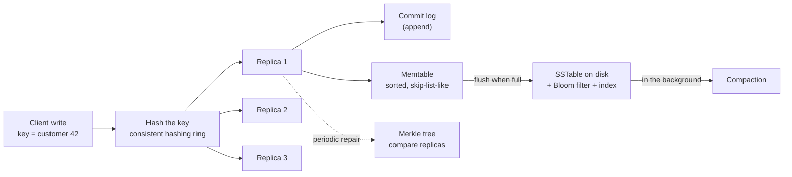

# Systems Data Structures Notes: B+ Trees, LSM Trees, Bloom Filters, Consistent Hashing, Skip Lists, Merkle Trees

Oct 14, 2026 · @Rishabh Toki

The teaching companion to
[systems-data-structures.md](../data-structures/systems-data-structures.md). These are the
data structures that sit **inside** databases, caches and distributed stores, and the ones
architect interviews ask about. The system-level "why" is already in
[data-architecture.md](../data/data-architecture.md) (indexing, LSM, sharding, caching) and
[data-architecture-notes.md](data-architecture-notes.md); this file is about the
**structures themselves**: how each one works, step by step, and what it costs.

> **Status: preview — not yet read.** Written ahead of reading, like the other DSA notes.

## How this file is organised

| Level | Goal | What you get |
|---|---|---|
| [**Level 1: The simple version**](#level-1-the-simple-version) | Know what each structure is *for* | Six problems, six tools, in plain words, with one running scenario |
| [**Level 2: How each one works**](#level-2-how-each-one-works) | Do it by hand | Pseudocode, then Java where useful, for each structure, with traces |
| [**Level 3: Deep dive**](#level-3-deep-dive) | Know the costs and trade-offs | Page sizes and fan-out, amplification, false-positive maths, virtual nodes, and how they combine in a real system |
| [**Level 4: Architect interview playbook**](#level-4-architect-interview-playbook) | Answer the questions | A model Q&A, how to choose, common mistakes, practice prompts |

**The running scenario:** an online shop with **500 million orders**, stored across many
servers. Each structure solves one of its problems.

---

## Level 1: The simple version

### Six problems, six tools

Everything below exists because of one hardware fact: **disks and networks are slow
compared with memory**, and one scale fact: **one machine is not enough**. Each structure
answers one concrete problem.

| The problem (in the shop) | The structure | A one-line picture |
|---|---|---|
| "Find order #123,456,789 on disk in a few reads, and list orders from March" | **B+ tree** | A book's index, with very wide pages |
| "Absorb thousands of new orders per second without slow random disk writes" | **LSM tree** | Write in a notebook; tidy up into sorted files later |
| "Is this order ID in this big file? Don't read the file just to say no." | **Bloom filter** | A guest list that says *definitely not here* or *maybe here* |
| "Which of our 50 servers holds customer 42, and what moves when we add a server?" | **Consistent hashing** | Servers sitting on a clock face; a key belongs to the next server clockwise |
| "Keep a sorted in-memory list that is simple and works with many threads" | **Skip list** | A sorted linked list with express lanes |
| "Are these two copies of the orders in sync? Which part differs?" | **Merkle tree** | A fingerprint of fingerprints |

### In plain words

**B+ tree.** A tree where each node is a whole **disk page** holding hundreds of keys, not
two. Because nodes are so wide, the tree is only 3 or 4 levels deep even for hundreds of
millions of rows, so finding a row takes 3 or 4 page reads. The bottom level (the
*leaves*) is a sorted, linked list, so "all orders from March" is one lookup followed by a
walk along the leaves. This is the index in Postgres, MySQL and most relational databases.

**LSM tree.** Updating a file in place needs a slow random write. An LSM tree **never edits
anything on disk**. New data goes into a sorted in-memory buffer (and a log for safety).
When the buffer fills, it is written out as a new, sorted, read-only file. Old and new
files are merged in the background. Writes become fast sequential appends; reads have to
check a few files. This is the engine in Cassandra, RocksDB and HBase.

**Bloom filter.** A tiny bit-array that answers "is X in the set?" with either **"definitely
not"** or **"probably yes"**. It never forgets an item that was added, so "no" is always
right; "yes" is occasionally wrong. Its use: before reading a large file from disk, ask the
filter first, and skip the file whenever it says "definitely not".

**Consistent hashing.** Spreading keys over servers with `hash(key) % numberOfServers`
breaks when you add a server: almost every key moves. Consistent hashing puts both servers
and keys on a circle (a "ring"); a key belongs to the **first server clockwise** from it.
Adding a server only takes over the keys right before it. Everything else stays put.

**Skip list.** A sorted linked list is easy to build but slow to search (`O(n)`). A skip
list adds extra "express lane" levels above it, chosen by coin flips, so a search can leap
ahead and then drop down. It gives `O(log n)` like a balanced tree, with much simpler code
and no rotations, which makes it friendly to concurrent use.

**Merkle tree.** Hash every data block; then hash pairs of hashes; repeat until one hash
remains at the top: the **root hash**, a fingerprint of all the data. If two replicas have
the same root hash, they hold identical data. If not, compare children to zero in on the
differing block, without sending the data.

### The one-minute picture of how they fit together

A write arrives for customer 42. **Consistent hashing** picks the servers that own it. On
each, the write goes into an **LSM tree**: appended to a log, inserted into an in-memory
**skip list**, and later flushed to a sorted file that has a **Bloom filter** attached. A
read first asks the Bloom filters which files might hold the key. In the background,
replicas compare **Merkle trees** to find and repair differences. A relational database
instead keeps its rows and indexes in **B+ trees**.

### Level 1 check

1. Why does a B+ tree stay only 3–4 levels deep for hundreds of millions of rows?
2. What are the only two answers a Bloom filter can give, and which one can be wrong?
3. Why does `hash(key) % N` cause trouble when `N` changes?
4. What does an LSM tree do instead of updating data in place?
5. What is a Merkle root, and what does it tell you if two replicas' roots are equal?

---

## Level 2: How each one works

### The B+ tree, step by step

**Structure.**

- Every node is one **disk page** (commonly 4–16 KB).
- **Internal nodes** hold sorted *separator keys* and child pointers. They exist only to
  route a search; they hold no row data.
- **Leaf nodes** hold the actual keys with their rows (or pointers to rows), in sorted
  order, and each leaf has a **link to the next leaf**.
- All leaves are at the **same depth**, so every lookup costs the same.
- Each node has a maximum number of keys. A node that overflows is **split**.

For an internal node with keys `k1 < k2 < …`, child 0 holds keys `< k1`, child 1 holds keys
`>= k1` and `< k2`, and so on.

**Search and range scan: the logic.**

```
SEARCH(key):
    node = root
    WHILE node is an internal node:
        choose the child whose key range contains key
        node = that child                          (one page read per level)
    look through the leaf for key
    RETURN the row, or "not found"

RANGE_SCAN(low, high):
    leaf = the leaf that SEARCH(low) ends on
    WHILE leaf exists:
        FOR EACH key in leaf, in order:
            IF key > high: STOP
            IF key >= low: output it
        leaf = the next leaf along the link           (no climbing back up the tree)
```

**Reading it:** descending costs one page read per level, so the cost is the tree's
height. A range query pays that descent **once**, then reads neighbouring leaves
sequentially, which disks are good at. That is why B+ trees suit queries like
`WHERE created_at BETWEEN …` and `ORDER BY`.

**Insert and split: the logic.**

```
INSERT(key):
    find the leaf where key belongs                (as in SEARCH)
    put key into that leaf, in sorted position
    IF the leaf now has too many keys:
        SPLIT the leaf into two halves
        COPY the first key of the right half UP into the parent as a separator
        IF the parent now has too many keys:
            SPLIT the parent, MOVE its middle key UP to the grandparent
            repeat upward as needed
        IF the root splits: create a new root         (the tree grows one level, at the top)
```

**Reading it:** the tree grows **upward from the root**, never downward, which is what
keeps all leaves at the same depth. Splitting a *leaf* **copies** the separator up (the
key must stay in the leaf, because leaves hold all the data). Splitting an *internal* node
**moves** its middle key up (internal keys are only signposts).

**Trace.** A tiny tree where each node holds at most **3 keys**. Insert `1 … 10` in order:

```
insert 1, 2, 3:      leaf [1 2 3]
insert 4:            [1 2 3 4] is too big → split leaves [1 2] and [3 4]; copy 3 up
                     root [3]  →  leaves [1 2] [3 4]
insert 5, 6:         [3 4 5 6] too big → split [3 4] [5 6]; copy 5 up
                     root [3 5]  →  leaves [1 2] [3 4] [5 6]
insert 7, 8:         [5 6 7 8] too big → split [5 6] [7 8]; copy 7 up
                     root [3 5 7]  →  leaves [1 2] [3 4] [5 6] [7 8]
insert 9, 10:        [7 8 9 10] too big → split [7 8] [9 10]; copy 9 up
                     root would be [3 5 7 9], too big → split the root:
                     the middle key 7 moves up to a NEW root
```

Final tree:

```
                    [ 7 ]
              /               \
        [ 3 | 5 ]             [ 9 ]
       /    |    \           /     \
  [1 2] → [3 4] → [5 6] → [7 8] → [9 10]        (leaves linked left to right)
```

Check the routing: searching for `6` goes root `[7]` (6 < 7, go left) → `[3|5]` (6 ≥ 5,
go right) → leaf `[5 6]`. A range scan for `4…8` descends to leaf `[3 4]` and then walks
`[5 6]` and `[7 8]` along the links.

**Sizing: why the tree is shallow.** With an 8 KB page and a 16-byte entry (8-byte key,
8-byte pointer), a node holds roughly **500** entries. Then:

| Levels | Rows addressable (roughly) |
|---|---|
| 1 | 500 |
| 2 | 250,000 |
| 3 | 125 million |
| 4 | 62 billion |

So a table of hundreds of millions of rows needs 3–4 levels, and the top levels stay
cached in memory, so a lookup is typically one or two actual disk reads. (Real pages are
not 100% full, usually two-thirds to three-quarters, so treat these as orders of
magnitude.)

Deletion is the mirror image of insertion: remove the key, and if a node becomes too
empty, borrow from a neighbour or **merge** nodes, which can shrink the tree from the
top. You are rarely asked to code it; know that it exists.

### The LSM tree, step by step

**Structure.** An LSM (log-structured merge) tree has an in-memory part and an on-disk
part:

- **Commit log:** an append-only file for crash recovery.
- **Memtable:** a sorted structure in memory (often a **skip list** or a balanced tree).
- **SSTables** (sorted string tables): immutable, sorted files on disk, each with a
  **sparse index** (every few hundred keys, with their file offsets) and usually a
  **Bloom filter**.
- **Tombstones:** a marker written in place of a delete.

**Write path: the logic.**

```
WRITE(key, value):
    append (key, value) to the COMMIT LOG              (sequential, durable)
    put (key, value) into the MEMTABLE                 (in memory, sorted)
    IF the memtable is full:
        write it out as a new SSTABLE, sorted          (one big sequential write)
        start a fresh memtable; the old log segment can be dropped

DELETE(key):
    WRITE(key, TOMBSTONE)                              (a delete is just another write)
```

**Read path: the logic.**

```
READ(key):
    look in the MEMTABLE: if found, RETURN it (a tombstone means "deleted")
    FOR EACH SSTABLE, from newest to oldest:
        ask its BLOOM FILTER: "might key be here?"
        IF "definitely not": skip this file             (saves a disk read)
        ELSE use the sparse index to find the block, read it, look for key
        IF found: RETURN it (a tombstone means "deleted")
    RETURN "not found"
```

**Compaction: the logic.**

```
COMPACT(several SSTABLES):
    MERGE them like merge sort (they are already sorted)
    FOR EACH key that appears more than once: keep only the NEWEST version
    drop keys whose newest version is a tombstone       (once it is safe to)
    write the result as a new SSTABLE; delete the old ones
```

**Reading it:** every disk write is a big sequential append, which is why LSM trees are
fast for writes. The price is paid on reads (several files might need checking, which Bloom
filters soften) and in the background (compaction rewrites data).

**Trace.**

```
write a=1, b=2           memtable {a=1, b=2}
memtable fills → flush   SSTable-1 = [a=1, b=2]
write a=5                memtable {a=5}
delete b                 memtable {a=5, b=TOMBSTONE}
read a                   memtable has a=5 → return 5          (newest wins)
read b                   memtable has a tombstone → "deleted"
flush                    SSTable-2 = [a=5, b=TOMBSTONE]
compact SSTable-1 + SSTable-2:
                         a: keep 5 (newer than 1);  b: newest is a tombstone → drop
                         SSTable-3 = [a=5]
```

For the system-level view (write amplification of 10–30x, leveled vs size-tiered
compaction, why LSM suits write-heavy workloads) see
[write-heavy patterns and why LSM trees exist](../data/data-architecture.md#deep-dive-write-heavy-patterns-and-why-lsm-trees-exist)
and [LSM stores](data-architecture-notes.md#9-lsm-stores).

### The Bloom filter, step by step

**Structure.** A bit array of `m` bits (all 0 to start) and `k` independent hash
functions, each of which maps an item to a position `0 … m-1`.

**The logic.**

```
ADD(item):
    FOR EACH of the k hash functions h:
        set bit  h(item)  to 1

MIGHT_CONTAIN(item):
    FOR EACH of the k hash functions h:
        IF bit  h(item)  is 0:  RETURN "definitely not"
    RETURN "probably yes"
```

**Reading it:**

- Adding an item switches on `k` bits. Bits are never switched off.
- If **any** of an item's `k` bits is 0, it can **never** have been added (adding it
  would have set them all). So "no" is certain.
- If all `k` bits are 1, they may have been set by *other* items that happened to overlap.
  That is a **false positive**: "yes" is only probable.
- You cannot list the items or delete one (clearing a bit could erase other items).

**Trace.** A toy filter: `m = 10` bits, `k = 3`. Suppose the hashes give:

| Item | Bit positions |
|---|---|
| `cat` | 1, 4, 7 |
| `dog` | 2, 4, 9 |
| `cow` | 1, 5, 9 |
| `emu` | 1, 2, 7 |

After `add(cat)` and `add(dog)`, the bits set are `{1, 2, 4, 7, 9}`.

- `mightContain(cat)`: bits 1, 4, 7 all set → "probably yes" (correct).
- `mightContain(cow)`: bit 5 is not set → **"definitely not"** (correct and certain).
- `mightContain(emu)`: bits 1, 2, 7 are all set (by `cat` and `dog`) → "probably yes", but
  `emu` was never added: a **false positive**.

**The same thing in Java:**

```java
class BloomFilter {
    private final BitSet bits;
    private final int m, k;

    BloomFilter(int m, int k) { this.bits = new BitSet(m); this.m = m; this.k = k; }

    void add(String item) {
        int h1 = hash1(item), h2 = hash2(item);
        for (int i = 0; i < k; i++)
            bits.set(Math.floorMod(h1 + i * h2, m));       // the i-th position, from two hashes
    }

    boolean mightContain(String item) {
        int h1 = hash1(item), h2 = hash2(item);
        for (int i = 0; i < k; i++)
            if (!bits.get(Math.floorMod(h1 + i * h2, m)))
                return false;                              // definitely not present
        return true;                                       // probably present
    }
    // hash1 / hash2: two well-mixed hashes of the item (for example the two halves of a
    // 64-bit MurmurHash). Combining them as h1 + i*h2 generates k positions cheaply.
}
```

**Sizing.** For `n` items and a target false-positive rate `p`:

```
m = - n · ln(p) / (ln 2)²        bits in total
k = (m / n) · ln 2               hash functions
```

For one million items at a 1% false-positive rate: about **9.6 bits per item**, so roughly
**1.2 MB**, with `k ≈ 7`. A tenth of that rate (0.1%) costs about 14.4 bits per item. The
filter is tiny compared with the data it protects.

### Consistent hashing, step by step

**Structure.** Imagine the output range of a hash function bent into a **circle** (the
ring), for example positions `0 … 2³² − 1`. Hash each **server** onto the ring. Hash each
**key** onto the ring too. A key belongs to the **first server found moving clockwise**
from its position (wrapping past the top back to the start).

**The logic.**

```
BUILD THE RING:
    FOR EACH server s:
        position = hash(s)
        store  position → s  in a SORTED map

SERVER_FOR(key):
    position = hash(key)
    find the first server position at or after  position    (clockwise)
    IF there is none: wrap around to the very first position on the ring
    RETURN that server

ADD_SERVER(s):    put hash(s) → s on the ring;
                  only keys between the previous server and s move to s
REMOVE_SERVER(s): take it off the ring;
                  its keys fall to the next server clockwise
```

**Reading it:** a sorted map (like the `TreeMap` from the [trees notes](trees-notes.md#7-treemap-and-treeset))
does the whole job. "First position at or after" is exactly `ceilingEntry`, and the wrap
is `firstEntry`.

**Trace.** A toy ring of positions `0 … 99` with servers A at 10, B at 40, C at 70:

```
key at 55 → first server at/after 55 is C (70)         → C
key at 95 → nothing at/after 95 → wrap to the start    → A (10)
key at 25 → B (40)                                     → B
```

Add a server **D at 50**: only keys at positions `41 … 50` (previously going to C) now go
to D. Keys for A, B and the rest of C are untouched. With `hash(key) % N`, going from 3 to
4 servers moves about **75%** of keys; with a ring it moves about **1/(N+1) = 25%**, and
only *onto* the new server.

**Virtual nodes.** With only a few points on the ring, servers get uneven slices. So each
physical server is placed at **many** positions ("virtual nodes", say 100–256 of them):

```
ADD_SERVER(s):
    FOR i from 0 to V-1:  put hash(s + "#" + i) → s  on the ring
```

This evens out the load, and when a server dies, its many small slices fall to many
different neighbours instead of one.

**The same thing in Java:**

```java
class HashRing {
    private final TreeMap<Integer, String> ring = new TreeMap<>();
    private final int virtualNodes;

    HashRing(int virtualNodes) { this.virtualNodes = virtualNodes; }

    void addNode(String node) {
        for (int i = 0; i < virtualNodes; i++)
            ring.put(hash(node + "#" + i), node);
    }

    void removeNode(String node) {
        for (int i = 0; i < virtualNodes; i++)
            ring.remove(hash(node + "#" + i));
    }

    String nodeFor(String key) {
        if (ring.isEmpty()) return null;
        Map.Entry<Integer, String> e = ring.ceilingEntry(hash(key));    // first node at or after the key
        return (e != null ? e : ring.firstEntry()).getValue();           // wrap around the ring
    }

    private int hash(String s) {                       // a small mixing step; use MurmurHash3 in production
        int h = s.hashCode();
        h ^= h >>> 16; h *= 0x85ebca6b; h ^= h >>> 13; h *= 0xc2b2ae35; h ^= h >>> 16;
        return h;
    }
}
```

**Replication on the ring.** To keep `R` copies, store a key on the first server clockwise
**and the next `R − 1` distinct physical servers** after it (skipping other virtual nodes of
a server already chosen).

### The skip list, step by step

**Structure.** Start with a sorted linked list on level 0 that contains every item. Build
level 1 above it containing about **half** the items, level 2 about a quarter, and so on.
Each level is a sorted linked list, and an item on a high level also appears on every level
below it. Which items are promoted is decided by **coin flips** when they are inserted.

```
level 2:  head ──────────────────────► 30 ───────────────────► nil
level 1:  head ──────► 10 ───────────► 30 ───────► 50 ───────► nil
level 0:  head ► 5 ──► 10 ──► 20 ───► 30 ──► 40 ─► 50 ─► 60 ► nil
```

**Search: the logic.**

```
SEARCH(key):
    cur = head, starting at the TOP level
    FOR level from top DOWN to 0:
        WHILE the next node on this level has a key smaller than key:
            move right to it
        (the next node is too big, or there is none: drop one level)
    cur = the next node on level 0
    RETURN cur exists AND cur.key == key
```

**Reading it:** at the top, big leaps skip many items; when the next leap would overshoot,
drop a level for smaller leaps, until level 0 takes the last small steps. It is binary
search done on a linked list.

**Trace.** Search `40` in the list above: start at `head` on level 2; the next is `30 < 40`,
move to 30; next is `nil`, drop. Level 1: next after 30 is `50`, too big, drop. Level 0:
next after 30 is `40`, which is not less than 40, so stop and check it: found.

**Insert: the logic.**

```
INSERT(key):
    walk down as in SEARCH, remembering for each level the LAST node before key's spot
    height = 1
    WHILE a coin flip comes up heads (and height < max): height = height + 1
    create a new node of that height
    FOR each level from 0 up to height-1:
        splice the new node in after the remembered node for that level
```

**Reading it:** insertion is a search plus local pointer splices; there are no rotations
and no rebalancing. A node's height is random, so on average half the nodes are 1 high, a
quarter are 2 high, and so on: the "express lanes" appear automatically.

**The same thing in Java:**

```java
class SkipList {
    static final int MAX_LEVEL = 16;

    static class Node {
        int key;
        Node[] next;
        Node(int key, int levels) { this.key = key; this.next = new Node[levels]; }
    }

    private final Node head = new Node(Integer.MIN_VALUE, MAX_LEVEL);
    private int level = 1;                                  // levels currently in use
    private final Random rnd = new Random();

    private int randomLevel() {                             // flip a coin until tails
        int lvl = 1;
        while (lvl < MAX_LEVEL && rnd.nextBoolean()) lvl++;
        return lvl;
    }

    boolean contains(int key) {
        Node cur = head;
        for (int i = level - 1; i >= 0; i--)
            while (cur.next[i] != null && cur.next[i].key < key)
                cur = cur.next[i];                          // move right
        cur = cur.next[0];                                  // (dropping down is the loop)
        return cur != null && cur.key == key;
    }

    void insert(int key) {                                  // duplicates not handled
        Node[] update = new Node[MAX_LEVEL];
        Node cur = head;
        for (int i = level - 1; i >= 0; i--) {
            while (cur.next[i] != null && cur.next[i].key < key)
                cur = cur.next[i];
            update[i] = cur;                                // last node before the spot, on level i
        }
        int lvl = randomLevel();
        if (lvl > level) {
            for (int i = level; i < lvl; i++) update[i] = head;
            level = lvl;
        }
        Node n = new Node(key, lvl);
        for (int i = 0; i < lvl; i++) {
            n.next[i] = update[i].next[i];                  // splice in on each level
            update[i].next[i] = n;
        }
    }
}
```

**Cost:** expected `O(log n)` for search, insert and delete (about `2·log₂ n` steps), and
about 2 pointers per item on average. The worst case is `O(n)` but astronomically unlikely.

### The Merkle tree, step by step

**Structure.** A binary tree of hashes:

- **Leaves:** the hash of each data block.
- **Internal nodes:** the hash of their two children's hashes joined together.
- **Root:** one hash that depends on **every** block.

**Build: the logic.**

```
BUILD(blocks):
    level = [ hash(block) for each block ]               (the leaves)
    WHILE level has more than one hash:
        next = empty
        FOR EACH adjacent pair (left, right) in level:   (if one is left over, pair it with itself)
            append  hash(left + right)  to next
        level = next
    RETURN the single remaining hash                     (the Merkle root)
```

**Compare two trees: the logic.**

```
DIFF(a, b):                          (a and b are the same position in two trees)
    IF hash(a) == hash(b): RETURN nothing                (this whole part is identical)
    IF a is a leaf:        RETURN this block             (found a block that differs)
    RETURN  DIFF(a.left, b.left)  +  DIFF(a.right, b.right)
```

**Reading it:** equal hashes prove a whole subtree is identical, so we **skip** it without
looking inside. Only the branches whose hashes differ are explored, which leads straight to
the changed blocks.

**Trace.** Four blocks, hashes `h1 … h4`; `h12 = H(h1+h2)`, `h34 = H(h3+h4)`,
`root = H(h12+h34)`. Replica B has a different block 3.

```
compare roots:      different      → look inside
compare h12:        same           → skip blocks 1 and 2 entirely
compare h34:        different      → look inside
compare h3:         different      → block 3 differs   ← found
compare h4:         same           → skip
→ only block 3 needs to be copied
```

The number of hash comparisons is about `log₂ n` per differing block, instead of comparing
all `n` blocks.

**Inclusion proof.** To prove block `i` belongs to a tree with a known root, send the
block plus the **sibling hash at each level** on the path to the root (`log₂ n` hashes).
The verifier recomputes upward and checks it equals the root. This is how a client can
trust one item without downloading the whole data set.

### Level 2 check

1. Insert `1…7` into a B+ tree with at most 3 keys per node. Draw the tree and say which
   inserts caused splits.
2. Why does a B+ tree range scan walk along the leaves instead of climbing back up?
3. Walk a `read(b)` through the LSM trace above after `b` was deleted. What does it return,
   and why must the tombstone exist?
4. With the toy Bloom filter, would `mightContain` for an item hashing to bits `{2, 4, 9}`
   say yes or no? Is that a true positive or a false positive?
5. Servers at ring positions 10, 40, 70 (ring `0…99`): which server owns keys at 5, 40, 41,
   and 99?
6. Search `20` in the skip-list picture, listing every pointer you follow.
7. Two Merkle trees over 8 blocks differ in block 6. How many leaf hashes do you compare?

---

## Level 3: Deep dive

### B+ tree in depth

**Why a B+ tree and not the structures you already know?**

| Candidate | Problem on disk |
|---|---|
| **Balanced binary tree** (AVL, Red-Black) | Height `log₂ n`: about 28 levels for 250 million rows, **each level a separate disk read** |
| **Hash index** | `O(1)` equality lookups, but **no ordering**: no range scans, no `ORDER BY`, no prefix matches |
| **Sorted array** | Fast to search, but every insert shifts everything |
| **B+ tree** | Wide nodes make it 3–4 levels deep; ordered; range scans follow the leaf links |

The real unit of cost on disk is the **page read**. A B+ tree is simply a balanced search
tree with the node size set equal to the page size, so each level costs exactly one read.

**B-tree vs B+ tree.** In a plain B-tree, internal nodes also store row data. In a B+ tree
they store **only keys**, so each internal page fits more separators, giving higher
fan-out and a shallower tree, and all data sits in the linked leaves, which makes range
scans trivial. That is why databases use B+ trees and still call them "B-trees".

**Clustered vs secondary indexes.**

- **Clustered index** (InnoDB's primary key): the leaves hold the **whole row**. The table
  *is* the B+ tree, ordered by primary key.
- **Secondary index:** leaves hold the indexed column plus the **primary key** (InnoDB) or
  a row location (Postgres). A lookup through a secondary index therefore costs a second
  lookup to fetch the row, unless the index is **covering** (contains every column the
  query needs). See [indexing and query performance](../data/data-architecture.md#indexing-and-query-performance)
  for composite and covering indexes.

**Write cost and fragmentation.**

- Inserting into a full page causes a **split**, which can ripple up. Splits touch several
  pages and, on random keys, scattered ones.
- **Sequential keys** (auto-increment, time-ordered IDs) always insert into the rightmost
  leaf: cheap and compact. **Random keys** (UUIDv4) insert all over the tree: many splits,
  half-empty pages and poor cache behaviour. This is why random UUID primary keys hurt
  InnoDB and why time-ordered IDs are preferred.
- Updates are done **in place** (random I/O), protected by a **write-ahead log** for crash
  safety. Every extra index is another B+ tree to update on each write: "indexes are a
  write tax".
- Page **fill factor** trades read density against room for future inserts.

**Where used:** PostgreSQL, MySQL/InnoDB, Oracle, SQL Server, SQLite, MongoDB's WiredTiger,
and the file-system metadata of many systems.

### LSM tree in depth

**The three amplifications.**

| | Meaning | LSM tree | B+ tree |
|---|---|---|---|
| **Write amplification** | Bytes physically written per byte logically written | **High** (compaction rewrites data; 10–30x is normal) | Moderate (page rewrite plus log) |
| **Read amplification** | Files or pages touched per read | **Higher** (several SSTables; Bloom filters help) | Low (3–4 pages) |
| **Space amplification** | Disk used per byte of live data | Higher (old versions and tombstones until compaction) | Low |

**Compaction strategies.**

| | Size-tiered | Leveled |
|---|---|---|
| Idea | Merge SSTables of similar size when there are enough | Keep levels of non-overlapping files, each level ~10× the last |
| Write amplification | **Lower** | Higher |
| Read amplification | Higher (key may be in many overlapping files) | **Lower** (about one file per level) |
| Space amplification | Higher (needs headroom to merge) | Lower |
| Suits | Write-heavy, time-series | Read-heavy, point lookups |

**Why the memtable is a skip list.** It must be sorted (so it can be flushed as a sorted
file), support fast inserts, and be safe for many writer threads. A skip list does all
three with much less complexity than a concurrent balanced tree. LevelDB and RocksDB
default to one.

**Where used:** Cassandra, ScyllaDB, HBase, RocksDB and LevelDB (and the databases built on
them), and many time-series and key-value stores. The trade-off versus B+ trees is the
single most common storage-engine question. Full system-level treatment:
[data-architecture.md](../data/data-architecture.md#deep-dive-write-heavy-patterns-and-why-lsm-trees-exist).

### Bloom filters in depth

**False positives, precisely.** After inserting `n` items into `m` bits with `k` hashes,
the false-positive probability is about `(1 − e^(−kn/m))^k`. It **rises as the filter fills
up**: a filter sized for a million items and fed ten million becomes nearly useless
(almost all bits are 1). So size it for the expected `n`, or use a *scalable* Bloom filter
that adds layers.

**What it cannot do.** No deletion, no listing, no count. Variants:

- **Counting Bloom filter:** each cell is a small counter, so items can be removed (at
  several times the memory).
- **Cuckoo filter:** supports deletion and often uses less space at low false-positive rates.

**Where it earns its keep.**

- **LSM trees:** one filter per SSTable, so a read for a missing key skips almost every
  file.
- **Cache penetration:** a filter in front of the database rejects requests for keys that
  cannot exist, protecting the DB from a flood of misses (see the
  [caching failure modes](../data/data-architecture.md#caching)).
- **Web crawlers and deduplication:** "have we already seen this URL?" in a few bits per URL.
- **Browsers and security:** checking a URL against a large malicious-site list locally,
  contacting a server only on "maybe".
- **Joins in distributed databases:** send a small filter instead of a whole key list.

**The rule that makes it safe:** use it only where **a false positive is merely a wasted
check**, never where "yes" must be exact. The costly path (read the file, query the
database) still runs, just less often.

### Consistent hashing in depth

**Balance and hotspots.** Even with virtual nodes, hash placement is only statistically
even; a single very popular key (a "hot key") still lands on one server, and the ring
cannot fix that. Replicating hot keys, caching in front, or splitting a key are separate
mitigations. Different servers can also be given *different numbers* of virtual nodes in
proportion to their capacity.

**Alternatives.**

| Scheme | Idea | Notes |
|---|---|---|
| **Consistent hashing ring + virtual nodes** | As above | Dynamo, Cassandra, many caches and load balancers |
| **Fixed hash slots** (Redis Cluster) | Hash every key into one of **16,384 slots**; assign slots to nodes; move whole slots when rebalancing | No ring; rebalancing is explicit slot movement |
| **Rendezvous (highest random weight) hashing** | For a key, hash it together with each node and pick the node with the highest score | No ring to store; adding or removing a node still moves only about `1/N` of keys; costs `O(N)` per lookup |
| **Jump consistent hash** | A tiny function mapping a key to a bucket number `0 … N−1` | Very fast and memory-free, but nodes must be numbered buckets (cannot remove an arbitrary one) |

**Where used:** Dynamo-style stores (Cassandra, Riak), distributed caches (memcached
client libraries), CDNs and load balancers (to keep a user's requests on the same cache
server), and sharded databases. The sharding trade-offs are in
[partitioning and sharding](../data/data-architecture.md#partitioning-and-sharding) and
[rebalancing](../data/data-architecture.md#rebalancing).

**A limit worth knowing:** consistent hashing spreads keys by **hash**, so keys that are
adjacent in sort order land on different servers. That is why a hash-partitioned store is
poor at **range queries**, which need range partitioning.

### Skip lists in depth

| | Skip list | Balanced tree (Red-Black / AVL) |
|---|---|---|
| Search / insert / delete | Expected `O(log n)` (worst case `O(n)`, vanishingly rare) | `O(log n)` guaranteed |
| Code complexity | **Simple** | Rotations, colour or balance rules |
| Concurrency | **Easy**: inserting changes only a few local pointers, so lock-free versions exist | Hard: rotations touch distant nodes |
| Memory | About 2 pointers per item, variable-size nodes | 2–3 pointers per item |
| Range scans | **Excellent**: walk the bottom level | Needs in-order traversal |
| Cache behaviour | Pointer-chasing (so-so) | Pointer-chasing (so-so) |

**Where used:** Redis sorted sets (a skip list plus a hash table, giving both
`ZRANGE`-style range queries and `O(1)` score lookups), the memtable in LevelDB and
RocksDB, and Java's `ConcurrentSkipListMap` and `ConcurrentSkipListSet` (the concurrent
counterparts of `TreeMap` and `TreeSet`).

### Merkle trees in depth

**Anti-entropy in replicated stores.** Replicas of a key range drift apart over time
(missed writes, failures). To repair them, each replica builds a Merkle tree over its data,
and two replicas compare trees: equal roots mean nothing to do; otherwise `DIFF` finds the
exact differing ranges, and **only those** are streamed across. Dynamo introduced this,
and Cassandra's repair works this way. The cost is keeping the trees up to date (or
rebuilding them) and the CPU to hash.

**Other uses.**

- **Git:** commits point to trees of file hashes, so identical files and directories are
  stored once and changes are detected by comparing hashes. A Git history is a Merkle DAG.
- **Blockchains:** a block header holds the Merkle root of its transactions; an inclusion
  proof lets a light client verify one transaction.
- **Certificate Transparency and secure logs:** append-only Merkle trees allow auditing.
- **File sync and download verification:** verify chunks independently, and resume.

**Trade-offs.** Hashing costs CPU. Granularity matters: too few leaves and each mismatch
copies a big block; too many and the tree is large. Updating one leaf means rehashing
`log n` nodes up to the root.

### How they fit together: a Cassandra-style system



**Write:** the ring picks the replicas; each appends to its commit log and inserts into its
memtable; full memtables flush to SSTables; compaction tidies them in the background.

**Read:** the ring picks a replica; it checks the memtable, then the **Bloom filter** of
each SSTable to skip files that cannot hold the key, then the sparse index and the block.

**Repair:** replicas compare **Merkle trees** to find and copy only the data that differs.

Compare a **relational database**: one machine (or a few replicas), rows and indexes in
**B+ trees** updated in place, scaled up before it is scaled out. Choosing between the two
families is the topic of [choosing a datastore](../data/data-architecture.md#choosing-a-datastore--a-decision-framework).

### Level 3 check

1. Why is a balanced binary tree a bad index for data on disk, and what does a B+ tree
   change?
2. In InnoDB, why does a lookup through a secondary index sometimes need two B+ tree
   lookups, and what makes an index "covering"?
3. Why do random UUID primary keys hurt a B+ tree?
4. Compare size-tiered and leveled compaction on write, read and space amplification.
5. What happens to a Bloom filter's false-positive rate as you add far more items than it
   was sized for? How would you size one for 10 million items at 1%?
6. Why is consistent hashing a poor fit for range queries?
7. Why does Redis Cluster use 16,384 fixed slots instead of a ring?
8. Why is a skip list easier to make concurrent than a Red-Black tree?
9. How do two replicas use Merkle trees to repair, and why is it cheaper than comparing all
   the data?

---

## Level 4: Architect interview playbook

### Model Q&A

**1. Why do relational databases index with B+ trees rather than binary trees or hash tables?**
Disk cost is per page read. A B+ tree sets the node size to the page size, so it is 3–4
levels deep even for hundreds of millions of rows (high fan-out, because internal nodes hold
only keys). It keeps keys ordered, so range scans and `ORDER BY` follow the linked leaves.
A hash index cannot do ranges; a binary tree is far too deep.

**2. What is the difference between a B-tree and a B+ tree?**
In a B+ tree, only the leaves hold data; internal nodes hold only separator keys, so more
fit per page and the tree is shallower. The leaves are linked, which makes range scans
cheap. In a plain B-tree, internal nodes also store data.

**3. When would you choose an LSM-based store over a B+ tree one?**
For sustained, high write throughput (logs, events, time series, IoT), because writes are
sequential appends rather than random in-place updates. The price is read amplification,
write amplification from compaction, and space amplification. B+ trees win for
read-heavy, point-lookup and range-query workloads with moderate writes.

**4. What is a Bloom filter, and where do you use it?**
A bit array plus `k` hashes that answers "definitely not present" or "probably present", with
no false negatives and a tunable false-positive rate. It guards expensive lookups: skipping
SSTables in an LSM store, rejecting non-existent keys before they hit a database, and
de-duplicating URLs. It is only safe where a false positive costs a wasted check, and it
cannot delete.

**5. How would you size a Bloom filter?**
From the expected item count `n` and the acceptable false-positive rate `p`: about
`m = −n·ln p / (ln 2)²` bits and `k = (m/n)·ln 2` hashes. For 1 million items at 1% that is
roughly 1.2 MB and 7 hashes.

**6. What problem does consistent hashing solve?**
With `hash(key) % N`, changing `N` remaps almost every key, which invalidates caches and
forces massive data movement. A ring places servers and keys on a circle; a key belongs to
the next server clockwise, so adding or removing a server moves only about `1/N` of the keys,
and only to or from its neighbours.

**7. What are virtual nodes, and why use them?**
Each physical server occupies many positions on the ring. That evens out the load (few points
give uneven slices), lets stronger servers take more positions, and spreads a failed server's
load over many neighbours instead of dumping it on one.

**8. How would you design a distributed cache or key-value store's partitioning?**
Hash keys with consistent hashing and virtual nodes; replicate each key to the next `R`
distinct servers clockwise; use a quorum for reads and writes if needed; rebalance by adding
nodes (only a slice of keys moves); watch for hot keys, which the ring cannot spread. Note
that hash partitioning sacrifices range queries.

**9. Why do Redis and RocksDB use skip lists?**
They give `O(log n)` sorted operations and cheap range scans with far simpler code than a
balanced tree, and local pointer updates make concurrent access easy. Redis uses one for
sorted sets, and RocksDB for its in-memory write buffer.

**10. How do replicas detect and repair divergence efficiently?**
Each builds a Merkle tree over its data. They compare root hashes; if equal, they are
identical. If not, they compare children and descend only into the differing branches, so
they find the exact differing ranges in about `log n` comparisons per difference and
transfer only those. This is anti-entropy repair in Dynamo and Cassandra.

**11. A hash-partitioned store needs range queries. What do you do?**
Hash partitioning scatters adjacent keys, so a range query must ask every shard. Either use
**range partitioning** (with hotspot care), keep a secondary sorted structure or index, or
pick a composite key where the partition part is hashed and a clustering part is sorted
within the partition (the Cassandra/DynamoDB approach).

**12. Your service crawls billions of URLs and must skip ones already seen. What do you use?**
A Bloom filter for the first check: a few bits per URL, and no false negatives, so a URL you
have already crawled is never crawled twice. The cost is that a small fraction of genuinely
new URLs are wrongly skipped (false positives). If missing a URL is unacceptable, back it
with an exact store and use the filter only to avoid most lookups to it.

### Choosing the structure

| You need… | Use |
|---|---|
| Ordered on-disk index, range queries, balanced reads/writes | **B+ tree** |
| Very high write throughput, tolerate read/space amplification | **LSM tree** |
| Cheap "definitely not here" before an expensive lookup | **Bloom filter** |
| Spread keys over changing servers with minimal movement | **Consistent hashing** |
| Sorted in-memory structure, simple, concurrent | **Skip list** |
| Detect and locate differences between large copies | **Merkle tree** |
| Exact membership, no false positives | A `HashSet`, not a Bloom filter |
| Range queries across shards | Range partitioning or clustering keys, not a hash ring |

### Common mistakes

- **Treating a Bloom filter's "yes" as certain.** Only "no" is certain.
- **Undersizing a Bloom filter**, so the false-positive rate climbs as it fills.
- **Using `hash % N` for shards** that will change in number.
- **Too few virtual nodes**, giving uneven load.
- **Believing consistent hashing fixes hot keys.** It balances keys, not traffic to one key.
- **Using random UUIDs as clustered primary keys** in a B+ tree database.
- **Piling on indexes**, each one being another B+ tree to update on every write.
- **Ignoring compaction cost** when choosing an LSM store (it competes for disk I/O).
- **Confusing "B-tree" in database docs with a binary tree**: it is a wide, multiway,
  disk-page tree.
- **Quoting skip-list `O(log n)` as guaranteed**: it is expected, not worst-case.

### How to answer in an interview

1. **Start with the constraint** that forces the structure (disk page reads, slow random
   writes, network cost, scale beyond one machine).
2. **Name the structure and the one-line idea.**
3. **Give the cost** (`O(log n)`, pages read, bits per key, fraction of keys moved).
4. **State the trade-off honestly** (what it gives up).
5. **Connect to a real system** (Postgres, Cassandra, Redis, Git).

### Practice prompts

Answer each aloud in under two minutes, with no notes:

1. Explain how a lookup in a 500-million-row table touches only a few pages.
2. Walk through a write and a read in an LSM store, including where the Bloom filter helps.
3. Design the key distribution for a 20-node cache that must survive adding and removing
   nodes.
4. Explain to a non-technical manager what a Bloom filter does and why "maybe" is acceptable.
5. How would two data centres find out which records differ, without sending everything?
6. Compare B+ tree and LSM tree on read, write and space cost, and say which you would
   choose for an audit log and which for a banking ledger.
7. Why can't you do an efficient range query on a hash-partitioned store, and what do you do?

### Level 4 check

1. Give the five-step structure of a good answer, and apply it to "why LSM?".
2. For each of the six structures, state the problem it solves, its cost, and its main
   limitation, in one line.
3. A teammate proposes a Bloom filter to check whether a payment was already processed. What
   is wrong with that, and what would you do instead?
4. Which two structures in this file would you expect to find in a Cassandra node, and what is
   each used for?
