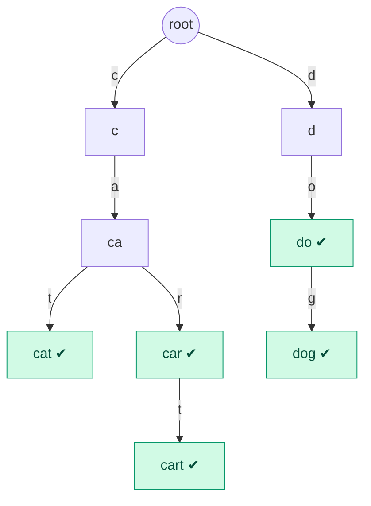
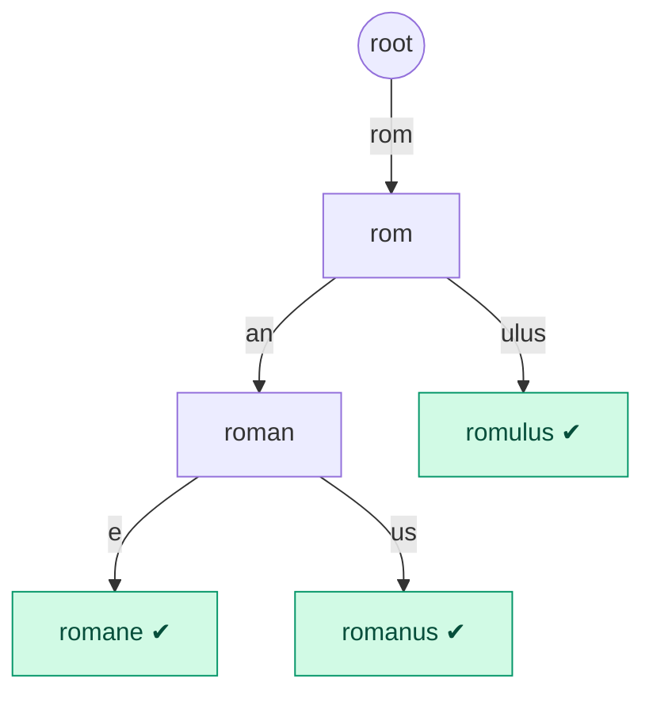

# Tries Notes: From the Prefix Idea to Autocomplete and Interview Problems

Oct 13, 2026 · @Rishabh Toki

The teaching companion to [tries.md](../data-structures/tries.md). A trie (pronounced
"try", from re*trie*val) is a tree built for **strings**: it stores words one character
per step, so words that start the same share the same path. It completes the tree family
from the [trees notes](trees-notes.md#the-map-how-all-the-trees-relate), where it sits
under *prefix trees*.

> **Status: preview — not yet read.** Moved here from the trees notes and expanded.

## How this file is organised

| Level | Goal | What you get |
|---|---|---|
| [**Level 1: The simple version**](#level-1-the-simple-version) | Know what a trie is and picture it | Plain words, one small picture, the vocabulary |
| [**Level 2: How it works**](#level-2-how-it-works) | Do it by hand | Pseudocode, then Java, for insert, search, prefix and autocomplete, with traces |
| [**Level 3: Deep dive**](#level-3-deep-dive) | Know the cost and the trade-offs | Complexity, memory, deletion, prefix counts, compressed tries, trie vs the alternatives |
| [**Level 4: Classic problems**](#level-4-classic-problems) | Solve the standard problems | Wildcard search, longest common prefix, and the ones that build on tries |
| [**Level 5: Interview playbook**](#level-5-interview-playbook) | Recognise and choose | Where tries show up, trie vs hash vs `TreeMap`, mistakes, a practice set |

**The running example:** the words `cat`, `car`, `cart`, `do`, `dog`.

---

## Level 1: The simple version

### What is a trie?

A **trie** stores a collection of words so that you can ask **prefix questions** quickly:
*"Is there any word that starts with `ca`?"* and *"List every word starting with `ca`."*
This is how autocomplete works: you type a few letters and the app lists the words that
begin with them.

The idea: instead of storing each word as a whole, store it **one letter at a time along
a path**. Words that begin with the same letters **share** that part of the path.

### Seeing it

The words `cat`, `car`, `cart`, `do` and `dog` as a trie. Each box is labelled with the
prefix you have spelled so far on the way down from the root; ✔ marks a place where a
complete word ends.



Things to notice:

1. `cat`, `car` and `cart` **share** the path `c → a`. Storing them in a list would repeat
   `ca` three times.
2. `car` is a word **and** also a stepping stone toward `cart`. That is why we need the ✔
   marker: reaching a node does not by itself mean a word ends there. (`ca` is on the
   path but is not a word; `car` is.)
3. The **edges** carry the letters; the node only represents "the prefix spelled so far".
4. There is no ordering rule like a BST's. A node's children are simply "one per next
   letter".

### Vocabulary

| Term | Meaning | In the picture |
|---|---|---|
| **Root** | The empty prefix, where every search starts | `root` |
| **Edge** | One character | the `c`, `a`, `t` labels |
| **Node** | A prefix spelled so far | `ca`, `car`, … |
| **End-of-word flag** | "A stored word ends at this node" | the ✔ nodes |
| **Prefix** | The first few letters of a word | `ca` is a prefix of `cat`, `car`, `cart` |

### Why not just use a list or a hash set?

A `HashSet` answers *"is `cart` stored?"* instantly, but for *"which words start with
`ca`?"* it has no choice except checking **every** word. A trie answers it by walking two
letters down and then reading everything below. That is the whole reason tries exist.

### Level 1 check

1. In the picture, is `ca` a stored word? Is `car`? How do you tell?
2. Which words share the path `c → a`?
3. Why do we need the end-of-word flag at all?
4. Why is a `HashSet` poor at "all words starting with `ca`"?
5. Draw the trie for the words `to`, `tea`, `ten`.

---

## Level 2: How it works

### The node

Each node needs two things: **where to go for each possible next letter**, and **whether
a word ends here**. For lowercase English, that is an array of 26 slots.

```java
class TrieNode {
    TrieNode[] next = new TrieNode[26];    // next[0] = child for 'a', next[1] = 'b', …
    boolean end;                           // does a stored word end at this node?
}
```

The slot for a letter `ch` is `ch - 'a'`, so `'a'` is slot 0 and `'c'` is slot 2.

### Insert

**The logic, step by step:**

```
INSERT(word):
    node = root
    FOR EACH letter ch in word:
        IF node has no child for ch:
            create a new child node for ch
        node = the child of node for ch              (step down one level)
    mark node as END OF WORD
```

**Reading it:**

- We walk down from the root, one letter per step.
- Where the path already exists (a shared prefix), we just follow it. Where it does not,
  we **create** the missing node. That is the only place new nodes are made.
- After the last letter, we are standing on the node for the whole word, so we set its
  flag.

**The same thing in Java:**

```java
void insert(String word) {
    TrieNode node = root;
    for (char ch : word.toCharArray()) {
        int i = ch - 'a';
        if (node.next[i] == null) node.next[i] = new TrieNode();
        node = node.next[i];
    }
    node.end = true;
}
```

**Trace: insert `car`, then `cart`, then `cat`.**

```
insert "car":   root → c (new) → a (new) → r (new);        mark r as END
insert "cart":  root → c (exists) → a (exists) → r (exists) → t (new);   mark t as END
insert "cat":   root → c (exists) → a (exists) → t (new);  mark t as END
```

Only 4 new nodes after the first word, because the shared prefix `ca` (and `car`) was reused.

### Search and prefix check

Both start by walking the word down the trie. They differ only in what they ask at the
end.

**The logic, step by step:**

```
FIND_NODE(text):
    node = root
    FOR EACH letter ch in text:
        IF node has no child for ch: RETURN none       (the path breaks: nothing stored this way)
        node = the child of node for ch
    RETURN node

SEARCH(word):        (is this exact word stored?)
    node = FIND_NODE(word)
    RETURN node exists AND node is marked END OF WORD

STARTS_WITH(prefix): (does any stored word begin with this?)
    RETURN FIND_NODE(prefix) exists
```

**Reading it:**

- `FIND_NODE` just follows the letters and gives up the moment a letter has no child.
- `SEARCH` also needs the end flag, because the path may be only a *prefix* of something
  longer.
- `STARTS_WITH` only needs the path to exist. If you got there, at least one stored word
  continues from that point (every path in a trie was built by inserting a word).

**The same thing in Java:**

```java
TrieNode findNode(String text) {
    TrieNode node = root;
    for (char ch : text.toCharArray()) {
        node = node.next[ch - 'a'];
        if (node == null) return null;
    }
    return node;
}

boolean search(String word)       { TrieNode n = findNode(word);   return n != null && n.end; }
boolean startsWith(String prefix) { return findNode(prefix) != null; }
```

**Trace** on the trie from Level 1 (`cat`, `car`, `cart`, `do`, `dog`):

| Call | Walk | Result | Why |
|---|---|---|---|
| `search("cart")` | c → a → r → t | **true** | path exists and `t` has the flag |
| `search("ca")` | c → a | **false** | path exists but `a` has no flag |
| `startsWith("ca")` | c → a | **true** | the path exists |
| `search("cow")` | c → (no `o` child) | **false** | the path breaks at the second letter |
| `startsWith("dx")` | d → (no `x` child) | **false** | the path breaks |

### Autocomplete: every word with a given prefix

**The logic, step by step:**

```
SUGGESTIONS(prefix):
    node = FIND_NODE(prefix)
    IF node is none: RETURN an empty list
    results = empty list
    COLLECT(node, prefix, results)
    RETURN results

COLLECT(node, wordSoFar, results):
    IF node is marked END OF WORD: add wordSoFar to results
    FOR EACH child (letter ch, childNode) of node, in alphabetical order:
        COLLECT(childNode, wordSoFar + ch, results)
```

**Reading it:**

- First jump to the node for the prefix (this is the fast `O(L)` part).
- Then run a **depth-first walk** of the sub-trie below it, keeping the letters spelled so
  far. Every time we pass a flagged node, that is a complete word.
- Visiting children in alphabetical order gives the results in **alphabetical order for
  free**.

**The same thing in Java:**

```java
List<String> suggestions(String prefix) {
    List<String> results = new ArrayList<>();
    TrieNode node = findNode(prefix);
    if (node != null) collect(node, new StringBuilder(prefix), results);
    return results;
}

void collect(TrieNode node, StringBuilder sb, List<String> out) {
    if (node.end) out.add(sb.toString());
    for (int i = 0; i < 26; i++) {
        if (node.next[i] != null) {
            sb.append((char) ('a' + i));
            collect(node.next[i], sb, out);
            sb.deleteCharAt(sb.length() - 1);        // undo: back out before trying the next letter
        }
    }
}
```

**Trace:** `suggestions("ca")` jumps to the node `ca`, then explores `r` before `t`:
`car` (flagged, add), continue to `cart` (flagged, add), back up, then `cat` (add).
Result: `[car, cart, cat]`, already sorted.

### Level 2 check

1. Insert `to`, `tea`, `ten` into an empty trie. How many nodes are created in total
   (not counting the root)?
2. After inserting `cart` only, what do `search("car")` and `startsWith("car")` return?
3. Why does `search` need the end flag but `startsWith` does not?
4. What does `suggestions("d")` return for the example trie?
5. In `collect`, why do we delete the last character after each recursive call?

---

## Level 3: Deep dive

### Complexity

Let `L` be the length of the word, and `N` the number of words stored.

| Operation | Time | Why |
|---|---|---|
| `insert`, `search`, `startsWith` | **`O(L)`** | One step per letter. **Independent of `N`.** |
| `suggestions(prefix)` | `O(L + size of the sub-trie below the prefix)` | Jump to the prefix, then visit everything below it |
| Space | up to `O(total letters stored)` nodes | Shared prefixes reduce this; unrelated words share nothing |

The key point: a lookup in a million-word dictionary costs the same as in a ten-word one,
because the work depends on the word, not the dictionary.

### Memory, and the array-vs-map choice

The weak spot of a trie is memory. Each node with a `TrieNode[26]` array reserves 26
reference slots even if it has one child, so most slots are `null`. As a rough guide that
is on the order of 100–200 bytes per node, and a large dictionary can have millions of
nodes.

| Children stored as | Memory per node | Lookup of a child | Use when |
|---|---|---|---|
| **Array** `TrieNode[26]` | High (26 slots) | `O(1)`, direct index | Small fixed alphabet (lowercase letters), dense tries |
| **`HashMap<Character, TrieNode>`** | Low (only real children) | `O(1)` average, but heavier per entry | Large or unknown alphabets (Unicode), sparse tries |
| **Sorted list / small array of pairs** | Lowest | `O(k)` for `k` children | Very sparse nodes |

### Deletion

Removing a word means clearing its end flag, and **also pruning** any nodes that are now
useless (no children and not the end of another word). Otherwise the trie slowly fills
with dead branches.

**The logic, step by step:**

```
DELETE(node, word, depth):          (returns true if `node` can now be removed)
    IF depth == length of word:
        IF node is not END OF WORD: RETURN false     (the word was never stored)
        clear node's END OF WORD flag
        RETURN node has no children                   (can it be pruned?)

    child = the child of node for word[depth]
    IF child is none: RETURN false                    (the word is not stored)
    IF DELETE(child, word, depth + 1) is true:
        remove the link from node to child            (prune the useless branch)
        RETURN node is not END OF WORD AND node has no children
    RETURN false
```

**Reading it:** go down to the word's last node and unflag it. On the way back **up**,
each node asks "am I now a dead end?" (no children, not a word of my own). If so it gets
cut off from its parent, and the question moves up another level. Deleting `cart` removes
only the final `t`; deleting `car` after that would remove `r` too, but not while `cart`
still hangs below it.

**The same thing in Java:**

```java
boolean delete(TrieNode node, String word, int depth) {
    if (depth == word.length()) {
        if (!node.end) return false;                  // word was never stored
        node.end = false;
        return isEmpty(node);
    }
    int i = word.charAt(depth) - 'a';
    TrieNode child = node.next[i];
    if (child == null) return false;                  // word not present
    if (delete(child, word, depth + 1)) {
        node.next[i] = null;                          // prune the dead branch
        return !node.end && isEmpty(node);
    }
    return false;
}

boolean isEmpty(TrieNode n) {
    for (TrieNode c : n.next) if (c != null) return false;
    return true;
}
```

### Counting words by prefix

A common extension: *"how many stored words start with `ca`?"* Add a counter to each node
that is incremented every time an insert **passes through** it.

```java
class TrieNode {
    TrieNode[] next = new TrieNode[26];
    boolean end;
    int pass;                                  // how many inserted words go through this node
}
// in insert: after stepping to the child, do   node.pass++;
// countPrefix(p) = findNode(p) == null ? 0 : findNode(p).pass
```

For the example trie the node `ca` has `pass = 3` (`cat`, `car`, `cart`), so the answer is
`O(L)`, with no need to walk the sub-trie. (If you support deletion, decrement the
counters on the way.)

### Compressed (radix / Patricia) tries

In a plain trie, a long unbranching chain such as `r → o → m → a → n → e` costs one node
per letter. A **compressed trie** merges every chain of single-child nodes into one edge
that holds a **string**. Words `romane`, `romanus` and `romulus`:



Same words, 5 nodes instead of 12 (not counting the root), and less memory, at the cost of more
complicated insert and delete code (edges must be split and merged). Radix trees are what
real systems use; IP routing tables and some key-value stores are built on them.

### Trie vs the alternatives

| | Trie | `HashSet` / `HashMap` | `TreeMap` / `TreeSet` | Sorted array + binary search |
|---|---|---|---|---|
| Exact lookup | `O(L)` | `O(L)` (hashing the string) | `O(L log N)` (log N comparisons, each up to L letters) | `O(L log N)` |
| **Prefix query** | **`O(L + results)`** | **`O(N·L)`**: scan everything | `O(L log N + results)` using `tailMap(prefix)` | `O(L log N + results)` |
| Sorted output | Free (walk children in order) | No | Yes | Yes |
| Memory | **High** | Low | Medium | Lowest |
| Shared-prefix savings | **Yes** | No | No | No |
| Per-prefix data (counts, top suggestions) | **Easy** (store it on the node) | Awkward | Awkward | Awkward |

Two honest points. First, a **`TreeMap` can also answer prefix queries** (jump to the
first key `>= prefix`, then read forward while keys still start with it), so a trie is not
the only option; its advantages are `O(L)` independent of `N`, shared storage and the
ability to hang extra data on each prefix. Second, for a **small** dictionary or an
occasional prefix query, a plain sorted structure is simpler, and the memory cost of a
trie is not worth it.

### Level 3 check

1. Why is a trie lookup `O(L)` however many words are stored?
2. Why does an array-based node waste memory, and when would you use a `HashMap` instead?
3. After inserting `car` and `cart`, delete `cart`. Which nodes disappear? Then delete `car`.
4. How would you answer "how many words start with `ca`?" in `O(L)`?
5. What does a compressed trie change, and what is the price?
6. When might a `TreeMap` be a better choice than a trie for prefix search?

---

## Level 4: Classic problems

### Implement a trie

This is the data structure from Level 2 with three methods (`insert`, `search`,
`startsWith`). It is the most common starting question: write the node class and those
three methods from memory.

### Search with wildcards: `.` matches any letter

**Question:** words are added to a dictionary, and a search such as `c.t` or `..r` must
match stored words, where `.` stands for any single letter.

**The logic, step by step:**

```
SEARCH_WILD(node, pattern, i):
    IF i == length of pattern: RETURN node is marked END OF WORD
    ch = pattern[i]
    IF ch is a normal letter:
        child = the child of node for ch
        RETURN child exists AND SEARCH_WILD(child, pattern, i + 1)
    ELSE (ch is '.'):
        FOR EACH child of node:
            IF SEARCH_WILD(child, pattern, i + 1): RETURN true
        RETURN false
```

**Reading it:** a normal letter follows its single path. A `.` could be any letter, so we
**try every child** and succeed if any branch works. This is where recursion earns its
keep: each try is a smaller version of the same problem.

**The same thing in Java:**

```java
boolean searchWild(TrieNode node, String pat, int i) {
    if (i == pat.length()) return node.end;
    char ch = pat.charAt(i);
    if (ch != '.') {
        TrieNode child = node.next[ch - 'a'];
        return child != null && searchWild(child, pat, i + 1);
    }
    for (TrieNode child : node.next)
        if (child != null && searchWild(child, pat, i + 1)) return true;
    return false;
}
```

On the example trie, `c.t` tries `c` → `a` (only child) → `t`: match `cat`. `..r` tries
every first letter, then every second, and needs `r` third: matches `car`.

### Longest common prefix of a list of words

**Idea:** insert all the words, then walk down from the root **as long as the current
node has exactly one child and no word ends there**. The letters you pass are the common
prefix.

**The logic, step by step:**

```
LONGEST_COMMON_PREFIX(words):
    build a trie from all the words
    prefix = empty
    node = root
    WHILE node has exactly ONE child AND node is not END OF WORD:
        prefix = prefix + that child's letter
        node = that child
    RETURN prefix
```

For `car`, `cart`, `cat`: root has one child `c`, then `a`; `a` has two children (`r`, `t`),
so we stop. Answer: `ca`. (For this problem, simply comparing the words letter by letter
is just as good and uses no extra memory; the trie version is useful when you already
have a trie.)

### Problems that build on tries

| Problem | The trie's role |
|---|---|
| **Autocomplete with top-k suggestions** | Jump to the prefix node, then collect the best `k` words below it, using a heap or by caching a "top k" list on each node |
| **Word Search II** (find many dictionary words in a letter grid) | Backtracking search on the grid, guided by the trie so that dead-end prefixes are pruned immediately. *Revisit after the recursion and backtracking topic.* |
| **Replace words** (swap each word for the shortest dictionary root that prefixes it) | Walk the trie along the word and stop at the first flagged node |
| **Maximum XOR of two numbers** | A trie over the *bits* of each number (alphabet of size 2); for each number walk to the opposite bit wherever possible |
| **Stream of characters** (does any recent suffix match a word?) | A trie of the *reversed* words, matched against the recent characters |

### Level 4 check

1. Write the node class and the three core methods from memory.
2. Using the example trie, which words match the patterns `d.g`, `..`, and `c..t`?
3. Why does the wildcard search recurse only on `.`?
4. In longest-common-prefix, why must we also stop at a node where a word ends? (Try
   `car` and `cart`.)
5. How could a trie help find two numbers in an array whose XOR is the largest?

---

## Level 5: Interview playbook

### Recognising a trie problem

| If the problem says… | Think |
|---|---|
| "starts with", "prefix", "autocomplete", "type-ahead" | Trie |
| A **dictionary** queried many times by prefix | Trie |
| "Does any word in the list start with…" | Trie |
| Search with wildcards (`.`, `?`) in a dictionary | Trie + recursion |
| Many words, shared beginnings, memory concern | Trie (or radix trie) |
| Longest prefix match (IP routing, URL routing) | Radix trie |
| Maximise XOR, binary decisions per bit | Trie over bits |
| Finding many words in a grid | Trie + backtracking |

### Choosing: trie, hash set, or sorted structure

| Need | Pick |
|---|---|
| Only exact "is it there?" | `HashSet` |
| Prefix queries, large dictionary, queried a lot | **Trie** |
| Prefix queries, small data, simplicity | Sorted array or `TreeMap` |
| Range queries by value, not by prefix | `TreeMap` |
| Extra data per prefix (counts, suggestions) | **Trie** |

### Where tries are used in real systems

Search-box autocomplete and spell-check suggestions; **IP routing** (longest-prefix match,
using a radix trie); phone-keypad predictive text (T9); URL and path routers in web
frameworks; some in-memory database indexes and key-value stores; lexicographic
sorting of strings.

### Common mistakes

- **Forgetting the end-of-word flag**, so `search("ca")` wrongly returns true.
- **Confusing `search` and `startsWith`.**
- **Assuming lowercase `a`–`z`.** Capitals, digits or Unicode break `ch - 'a'`; normalise
  the input or use a `HashMap` for children.
- **Deleting by only unflagging**, leaving dead branches (memory leak, wrong counts).
- **Ignoring memory** when the dictionary is huge; consider a `HashMap` or a radix trie.
- **Forgetting the empty string** and whether it counts as a word.

### Mixed practice set

For each, say the trie's role and the cost *before* coding.

| # | Problem | Trie's role |
|---|---|---|
| 1 | Implement a trie (`insert`, `search`, `startsWith`) | The structure itself |
| 2 | Add and search words with `.` wildcards | Recursive search over children |
| 3 | Longest common prefix | Walk while a single child |
| 4 | Autocomplete: all words with a prefix, sorted | Prefix node + DFS collect |
| 5 | Count words with a given prefix | Pass-through counter on each node |
| 6 | Replace words with their shortest root | Stop at the first flagged node |
| 7 | Design a search-suggestion system (top 3 per prefix) | Prefix node + cached or heap-based top-k |
| 8 | Maximum XOR of two numbers in an array | Binary trie |
| 9 | Word Search II | Trie + backtracking (after that topic) |
| 10 | Longest word built one letter at a time from other words | Trie where every prefix must be flagged |

### How to approach a new problem

1. **Is the question about prefixes (or bits), repeated many times?** If yes, a trie.
2. **What is the alphabet?** That decides array vs `HashMap` children.
3. **What extra data do I hang on a node?** A flag, a counter, a word, a top-k list?
4. **State the cost:** `O(L)` per operation, space proportional to the letters stored.
5. **Compare** with a `HashSet` or `TreeMap` solution and say why the trie wins (or does
   not).

### Level 5 check

1. You are building search-as-you-type for a million product names. Which structure, and
   what does each keystroke cost?
2. Why can't a `HashSet` do this efficiently?
3. When would you prefer a `TreeMap` over a trie for a prefix query?
4. What is stored at each node if you must return the top 3 suggestions per prefix?
5. Pick any three practice problems and, without coding, say what the trie stores and the
   cost of each operation.
